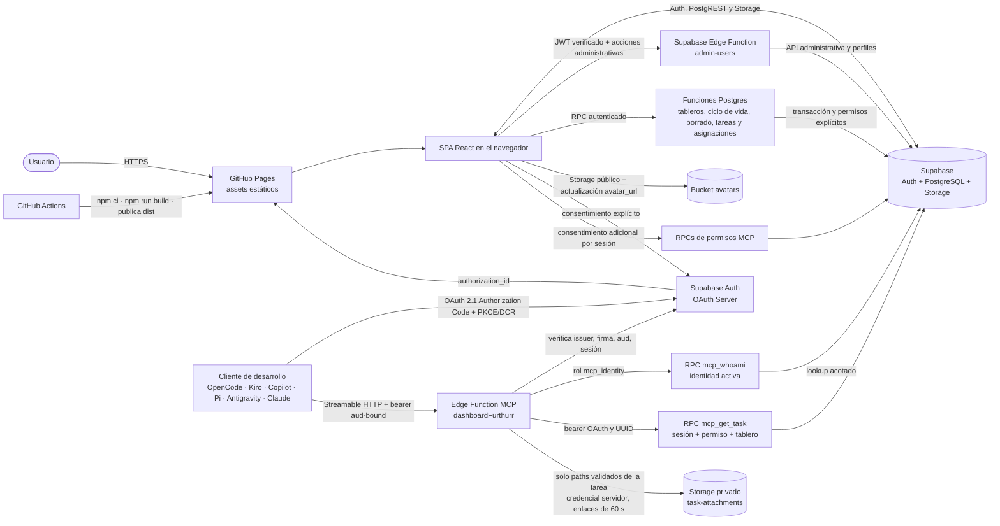

# Arquitectura — Dashboard Furthurr

Documentación canónica de arquitectura. Lee este archivo antes de cambiar límites entre módulos, integración con Supabase, routing o despliegue.

## Estado de sincronización

- Tecnología detectada: SPA React/TypeScript/Vite en GitHub Pages; Supabase Auth/PostgreSQL/Storage y Edge Functions `admin-users` y `mcp`, con OAuth 2.1 para clientes MCP.
- Modo: `lite`.
- Baseline Git consultado: `HEAD=be391defd2601dee3e7105d7ec14937f33f32efc` (`docs(mcp): ampliar documentación de OAuth y clientes`). `get_task`, consentimiento de lectura y esta documentación son cambios locales sin commit: **pendiente de baseline Git**, no se atribuyen a `HEAD`.
- Última sincronización focalizada: 2026-10-28; lectura MCP por UUID, consentimiento adicional por sesión, firma acotada de adjuntos y copia de ID. Se excluyen cambios ajenos de `BoardsPage`, `.sdd/` y lockfile raíz.
- Última evidencia remota registrada (no repetida aquí): Pages run `40796012117`, commit `267cc91`; `mcp` versión 2 y `admin-users` versión 6 ACTIVE; `202610280002` aplicada. No acredita despliegue de `get_task` ni aplicación de `202610280003`; la preparación está en [la guía de prueba](../docs/prueba-mcp.md).
- Commit base de implementación y primera sincronización: `eb25418de42c045d6be32a3091f8bb3f36b24ba0`.
- Las verificaciones remotas fechadas de 2026-10-21/22 y la publicación `v0.6.0` se conservan como historial; no prueban el estado remoto de los cambios locales actuales.
- Alcance: SPA, Auth, administración y perfiles, tableros/tareas/comentarios/adjuntos, Edge Functions, MCP de identidad y consulta de tarea (fase 2 local), autorización OAuth/Postgres/Storage, presets de clientes y despliegue.

## Contexto para IA

- **Sistema:** dashboard Kanban estático en GitHub Pages; datos/Auth/Storage mediante Supabase JS. Supabase también aloja `admin-users`, RPCs de negocio y el servidor MCP `dashboardFurthurr`; no hay servidor de aplicación independiente ni SSR (`src/App.tsx:27-55`, `supabase/functions/admin-users/index.ts:13-95`, `supabase/functions/mcp/index.ts:39-126`).
- **MCP local:** Streamable HTTP stateless anuncia `whoami` y `get_task`, versión de aplicación `0.2.0` (no es versión de protocolo MCP ni de despliegue Edge). OAuth/PKCE/DCR conserva rol aislado `mcp_identity`; JWT y `mcp_whoami()` verifican identidad/sesión por request. `mcp_get_task` exige además consentimiento por sesión y autorización explícita sobre la tarea. La firma de descargas es una operación servidor separada (`supabase/functions/mcp/index.ts:24-84,114-154`, `supabase/migrations/202610280003_mcp_task_read.sql:63-116`).
- **Distribución por cliente:** presets sin bearer ni secretos en `opencode.json`, `.kiro/settings/mcp.json`, `.vscode/mcp.json`, `.mcp.json`, `.agents/mcp_config.json` y `.pi/mcp.json`; la guía de selección está en `mcp/README.md`. Claude Desktop requiere el conector remoto de cuenta/organización.
- **Estilo:** features cliente `auth`, `boards`, `board` y `users`, providers globales y TanStack Query. Lecturas ordinarias acceden al SDK; las operaciones de autorización y traslado usan RPCs. No se documenta una capa de repositorios (`src/features/boards/api.ts`, `src/features/board/api.ts`).
- **Módulos y límites:** `auth` mantiene sesión/perfil y la vista de perfil; `users` administra cuentas y carga avatares; `shared/ui` presenta `AccountMenu` y `ProfileAvatar`; `boards` compone selector, creación, miembros, ciclo de vida y borrado permanente de tableros inactivos; `board` contiene Kanban, tareas, adjuntos, comentarios y `AssigneePicker`. `src/types/` define modelos. La autorización real reside en Postgres/Storage, no en la visibilidad de controles React.
- **Datos y permisos:** cada tarea tiene un tablero. El portal local permite acceso por membresía **o asignación** en un tablero activo, además del acceso de admin activo (`supabase/migrations/202610280001_board_assignment_access.sql:4-42`). El MCP es deliberadamente más estricto: no admin requiere membresía explícita y tablero activo; la asignación sola no basta (`202610280003_mcp_task_read.sql:78-88`). No sustituir la comprobación MCP por el helper más amplio del portal. RLS del portal y comprobaciones `SECURITY DEFINER` de MCP son fronteras distintas.
- **Perfil y avatar:** `profiles.avatar_url` referencia una imagen pública del bucket `avatars`; el cliente valida JPG/PNG/WebP hasta 2 MB, carga al path `<profile-id>/avatar` y actualiza el perfil (`src/features/users/avatarApi.ts:3-35`, `supabase/migrations/202610260003_profile_avatars.sql:5-10`). El bucket es público. En remoto se comprobaron las dos policies de escritura de avatar; la migration `202610260003` no consta en el ledger remoto, así que no se afirma que se haya aplicado como migration.
- **Ciclo de vida en la base de datos:** `boards.is_active` activa/desactiva un tablero sin borrar contenido ni membresías. Tres RPCs `SECURITY DEFINER` con `search_path = ''` lo sostienen: `list_boards_with_pending_counts` (catálogo visible con conteo de pendientes), `rename_board` y `set_board_active` (solo admin). La policy de lectura de `boards` no invoca funciones que lean `boards`, para no reintroducir la recursión que corrigió `202610220001_board_access_returning.sql` (`supabase/migrations/202610220002_board_lifecycle.sql:7-90`).
- **Borrado permanente:** el selector permite al admin eliminar solo un tablero desactivado; el cliente limpia sus objetos del bucket de adjuntos por lotes y después invoca `delete_inactive_board`, que vuelve a comprobar admin/estado y elimina tareas y tablero en una transacción. Storage y Postgres no forman una transacción común (`src/features/boards/api.ts:69-145`, `supabase/migrations/202610260002_delete_inactive_boards.sql:5-25`). La RPC no estaba presente en el proyecto remoto consultado el 2026-10-28; la UI local traduce `PGRST202` a instrucción de aplicar/reload. Esa UI no está en `HEAD`.
- **Regla de dependencias observada:** las páginas de feature pueden usar sus hooks/API locales, tipos compartidos y el cliente en `src/lib/`; la inicialización y el routing viven en `App.tsx` (`src/App.tsx:1-40`, `src/features/board/api.ts:1-21`). No asumir una separación por capas que el código actual no implementa.
- **Fuentes de verdad:** `specs/` contiene la intención funcional y las decisiones de producto (`AGENTS.md:33-40`); `supabase-schema.sql` es el schema SQL de referencia según `AGENTS.md:68-70`; el código actual describe el comportamiento implementado. Las carpetas `.data/` y `.design/` documentan sus respectivos dominios sin reemplazar esas fuentes.

## 1. Contexto y alcance

El tablero añade administración de cuentas y asignación múltiple de responsables. La SPA sigue alojada en GitHub Pages; las operaciones dinámicas se ejecutan en servicios gestionados de Supabase. La frase histórica «sin servidor propio» significa que no hay infraestructura de servidor independiente: **no implica ausencia de código backend** (`src/features/users/UsersPage.tsx`, `supabase/functions/admin-users/index.ts`, `supabase/migrations/202610200001_task_assignments.sql`).

## 2. Restricciones y decisiones estructurales

- `HashRouter` y base `/dashboardFurthurr/` se conservan. `/boards` requiere sesión/perfil activo; `/board/:boardId` requiere además acceso devuelto por RLS. `/board` redirige al selector; `/users` exige admin. `/register` redirige a `/users` (`src/App.tsx:24-42`, `src/features/boards/BoardRoute.tsx`).
- `/profile` está protegido para cuentas activas. `AccountMenu` permite cambiar el avatar propio, navegar a «Perfil» o, para admin, a «Usuarios»; la lista de administración permite cargar avatares de otras cuentas (`src/App.tsx:27-42`, `src/shared/ui/AccountMenu.tsx:17-41,58-83`, `src/features/users/UsersPage.tsx:37-54`).
- GitHub Pages no es un servidor de aplicación ni se documenta un rewrite de rutas; las instrucciones de proyecto especifican que Pages no reescribe las rutas SPA (`AGENTS.md:42-44`). El routing hash evita depender de ese rewrite (`src/App.tsx:1-2`).
- El build necesita `VITE_SUPABASE_URL` y `VITE_SUPABASE_PUBLISHABLE_KEY` (`src/lib/supabase.ts:3-10`); `.github/workflows/deploy.yml` los toma de secretos del workflow (`.github/workflows/deploy.yml:33-42`). Nunca documentar valores ni añadir credenciales al cliente.
- La autorización debe permanecer respaldada por RLS en Supabase (`supabase-schema.sql:164-168`, `supabase-schema.sql:198-234`); ocultar una acción o proteger una ruta en React no sustituye políticas de base de datos.
- MCP conserva el hook/audiencia y el rol `mcp_identity` sin herencia ni grants directos de tablas/vistas/Storage. Fase 2 agrega únicamente ejecución de `mcp_get_task` junto a `mcp_whoami`; no permite RPCs de escritura ni autoautorizar lectura (`supabase/migrations/202610280003_mcp_task_read.sql:39-40,60-61,115-116`).
- `whoami` y las lecturas usan el bearer OAuth solo para RPCs propias del recurso en el mismo Supabase. La firma de archivos usa `SUPABASE_SERVICE_ROLE_KEY` exclusivamente en Edge, después de la consulta autorizada y validación de origen, bucket y path `<task-id>/<archivo>`. La credencial no se comparte con el cliente ni se convierte en privilegios del rol OAuth (`supabase/functions/mcp/index.ts:50-84`, `supabase/functions/mcp/task.ts:49-92`).
- Supabase OAuth Server está en beta y DCR habilitado. El nombre declarado del cliente no demuestra confianza; el usuario revisa aplicación, callback y scopes en el consentimiento. El hook y el aislamiento aplican a sesiones OAuth del proyecto, no exclusivamente a MCP.
- La ampliación de la edición a todas las cuentas activas está contenida en dos capas: la policy `Active accounts can update tasks` abre el `UPDATE` de `tasks` a todo autenticado activo, y el permiso por columna impide escribir `created_by`. Sin esa segunda capa, un usuario podría reclamar la propiedad de una tarea ajena y después borrarla.
- El flujo de despliegue comprobado en `.github/workflows/deploy.yml` usa Node 20, `npm ci`, `npm run build`, carga `dist` y despliega a GitHub Pages desde `main` o mediante ejecución manual (`.github/workflows/deploy.yml:1-53`).

## 3. Bloques de construcción

| Bloque | Responsabilidad | Evidencia |
| --- | --- | --- |
| Entrada y composición | Monta React, providers, `HashRouter` y rutas | `src/main.tsx:6-10`, `src/App.tsx:1-40` |
| Auth | Sesión, perfil activo, limpieza de caché y refresco a los 30 s/al recuperar foco | `src/features/auth/AuthContext.tsx:27-98`, `src/features/auth/ProtectedRoute.tsx:9-34` |
| Users | Listado paginado, alta confirmada, nombre, contraseña, estado, promoción a admin y carga de avatares | `src/features/users/UsersPage.tsx`, `src/features/users/api.ts`, `src/features/users/avatarApi.ts` |
| Boards | Selector de tableros accesibles con secciones activa/desactivada, creación admin, gestión de miembros, renombrado, activar/desactivar y borrado permanente de inactivos; la ruta valida el acceso | `src/features/boards/BoardsPage.tsx`, `src/features/boards/BoardRoute.tsx`, `src/features/boards/api.ts` |
| Board | Columnas, tarjetas, modales, ordenamiento y mutaciones de tareas | `src/features/board/BoardPage.tsx:30-53`, `src/features/board/api.ts:5-29`, `src/features/board/BoardPage.tsx:97-147` |
| Comentarios y adjuntos | Hooks/API asociados a tareas y Storage; el detalle permite renombrar metadata y borrar objeto + fila | `src/features/board/commentsApi.ts:5-24`, `src/features/board/attachmentsApi.ts:12-71,181-204` |
| Cliente Supabase | Crea el cliente con las variables de entorno públicas requeridas | `src/lib/supabase.ts:1-10` |
| Perfil y avatares | `AccountMenu`/`UsersPage` reutilizan `ProfileAvatar`; `avatarApi` valida y sube imágenes a Storage y actualiza `profiles.avatar_url` | `src/shared/ui/AccountMenu.tsx:17-41,58-83`, `src/shared/ui/ProfileAvatar.tsx:17-45`, `src/features/users/avatarApi.ts:3-35` |
| Tipos compartidos | Roles, estados, prioridades y modelos de perfil/tablero/tarea/comentario/adjunto | `src/types/index.ts` |
| Servicio gestionado | Auth, persistencia, Storage y políticas RLS | `supabase-schema.sql:10-168`, `supabase-schema.sql:349-424` |
| Administración privilegiada | Verifica JWT con `auth.getUser`, rechaza tokens OAuth y exige admin activo antes de acciones de cuenta | `supabase/functions/admin-users/index.ts:20-38,44-91`, `supabase/functions/admin-users/validation.ts` |
| MCP local, fase 2 | Discovery, Streamable HTTP, `whoami` y `get_task`; validación Zod, paginación y firma acotada | `supabase/functions/mcp/index.ts:40-164`, `supabase/functions/mcp/task.ts:4-92` |
| Consentimiento/conexiones MCP | OAuth de identidad y autorización adicional de lectura de sesiones actuales; listar/retirar lectura y revocar grants | `src/features/auth/OAuthConnectionsPage.tsx:14-108`, `src/features/auth/mcpTaskAccess.ts:3-17`, `supabase/migrations/202610280003_mcp_task_read.sql:4-61` |
| Configuración por cliente MCP | Presets project-scoped sin credenciales y selector de instalación | `mcp/README.md`, `opencode.json`, `.kiro/settings/mcp.json`, `.vscode/mcp.json`, `.mcp.json`, `.agents/mcp_config.json`, `.pi/mcp.json` |
| Funciones transaccionales | Alta de tarea con responsables y sustitución completa de asignaciones | `supabase/migrations/202610200001_task_assignments.sql:7-76` |
| Políticas de edición compartida | Permisos por columna en `tasks` y policy de `UPDATE` para todo autenticado activo | `supabase/migrations/202610200002_shared_task_editing.sql:1-19` |
| Políticas de tableros | Membresías, aislamiento RLS de datos/Storage y RPCs para creación, traslado y gestión de miembros | `supabase/migrations/202610210001_boards.sql` |
| Ciclo de vida de tableros | Columna `boards.is_active`, RPCs `rename_board`/`set_board_active`/`list_boards_with_pending_counts` y policies reescritas sin recursión RLS | `supabase/migrations/202610220001_board_access_returning.sql`, `supabase/migrations/202610220002_board_lifecycle.sql` |
| Borrado de tablero inactivo | El cliente elimina primero adjuntos de Storage y llama a RPC admin que vuelve a validar estado inactivo y borra tareas/tablero con cascadas relacionales | `src/features/boards/api.ts:69-145`, `supabase/migrations/202610260002_delete_inactive_boards.sql:5-25` |

TanStack Query está configurado en `src/App.tsx` con `staleTime` de cinco minutos y un reintento (`src/App.tsx:10-17`); las queries de tareas, comentarios y adjuntos se definen junto a la feature correspondiente (`src/features/board/api.ts:24-29`, `src/features/board/commentsApi.ts:19-24`, `src/features/board/attachmentsApi.ts:16-22`). El tablero permite mover tareas con dnd-kit y dispone de sensor de teclado (`src/features/board/BoardPage.tsx:56-65`, `src/features/board/BoardPage.tsx:97-147`).

## 4. Flujos principales

### Inicio y acceso

1. `AuthProvider` recupera la sesión de Supabase y escucha cambios de autenticación (`src/features/auth/AuthContext.tsx:38-63`).
2. Con una sesión, obtiene el perfil desde `profiles`; sin sesión, limpia el estado (`src/features/auth/AuthContext.tsx:22-36`, `src/features/auth/AuthContext.tsx:43-48`).
3. `ProtectedRoute` redirige sin sesión, bloquea perfiles ausentes/inactivos y comprueba `adminOnly`. El perfil se refresca cada 30 segundos y al recuperar foco; se descartan respuestas de sesiones anteriores y se limpia la caché al cambiar identidad o perder acceso (`src/features/auth/ProtectedRoute.tsx:21-32`, `src/features/auth/AuthContext.tsx:27-98`).
4. Tras autenticarse, el usuario consulta el catálogo de tableros mediante la RPC `list_boards_with_pending_counts`, que replica la visibilidad de RLS y añade el conteo de pendientes; `BoardRoute` vuelve a comprobar acceso contra ese catálogo antes de montar el Kanban.
5. `BoardPage` consulta tareas por `board_id`; comentarios y adjuntos siguen sujetos a RLS del tablero (`src/features/board/api.ts`, `src/features/board/commentsApi.ts`, `src/features/board/attachmentsApi.ts`).

### OAuth MCP de identidad (base conservada en fase 2)

1. Un cliente seleccionado en `mcp/README.md` se conecta al endpoint MCP Streamable HTTP; sus presets no llevan bearer ni secreto.
2. Sin token, `mcp` responde 401 con Protected Resource Metadata. El cliente descubre Supabase Auth y registra un cliente público DCR/PKCE; GoTrue agrega `authorization_id` al root de Pages (`supabase/functions/mcp/index.ts:43-45,84-91`, configuración de Auth en `supabase/config.toml`).
3. `App.tsx` normaliza la query al hash de la SPA. Si no hay sesión, `LoginPage` conserva el ID opaco; `OAuthConsentPage` verifica que el user ID de la solicitud coincida con la sesión, ofrece aprobar/denegar y solo redirige al callback devuelto por Auth (`src/App.tsx:11-16,27-42`, `src/features/auth/mcpOAuth.ts:2-21,24-36`, `src/features/auth/OAuthConsentPage.tsx:18-50`).
4. El Custom Access Token Hook preserva tokens ordinarios y para OAuth requiere perfil activo; aplica `aud=<mcp_resource_url>` y `role=mcp_identity` (`supabase/migrations/202610280002_mcp_identity.sql:23-45`).
5. Por cada llamada, la Edge Function verifica firma, issuer, audience y claims; `mcp_whoami()` valida sesión viva, cliente y perfil activo. Fase 2 permite además la RPC de lectura acotada, no acceso genérico a PostgREST (`supabase/functions/mcp/index.ts:24-70,114-123`, `supabase/migrations/202610280002_mcp_identity.sql:47-74`).
6. El usuario revisa concesiones en `/profile/connections`; revocarlas elimina las sesiones OAuth y el MCP comprueba su existencia en cada request (`src/features/auth/OAuthConnectionsPage.tsx:15-41`, `supabase/migrations/202610280002_mcp_identity.sql:56-63`). El token OAuth no se convierte en sesión web ordinaria ni se reenvía a un proveedor de negocio.

### Consulta MCP de tarea (implementación local)

1. El usuario copia el UUID desde el icono de la tarjeta o el detalle; esto no concede permisos (`src/features/board/CopyTaskId.tsx:9-51`).
2. En Conexiones confirma «Autorizar lectura de tareas». La RPC del portal registra las sesiones OAuth vivas de ese usuario/cliente; reconexiones futuras no heredan el permiso. Retirar lectura no revoca `whoami`; eliminar la sesión borra el consentimiento por FK (`supabase/migrations/202610280003_mcp_task_read.sql:4-61`).
3. `get_task` valida UUID y paginación; la RPC revalida identidad, consentimiento y membresía/tablero activo o admin activo. Tarea ausente y tarea sin acceso producen el mismo resultado no disponible (`supabase/functions/mcp/task.ts:13-32`, `supabase/migrations/202610280003_mcp_task_read.sql:63-116`).
4. La respuesta contiene proyecciones de tarea/tablero/personas y páginas independientes de comentarios/adjuntos; no expone correos de terceros ni JWT. Los nombres y contenidos son datos no confiables, nunca instrucciones del sistema.
5. Edge elimina `file_url` interno y genera enlaces de 60 s solo para paths de la tarea y del origen/bucket esperado. Rutas antiguas, archivo ausente, fallo de firma o presupuesto agotado mantienen la metadata y devuelven `download_error`; no se lee el archivo (`supabase/functions/mcp/task.ts:49-92`). Retirar permisos no invalida enlaces ya emitidos ni datos descargados.

### Ciclo de vida de tableros

1. El selector pide el catálogo por RPC y lo separa en dos secciones según `is_active`: «Tableros activos» para todos y «Tableros desactivados» solo para admin activo (`src/features/boards/BoardsPage.tsx:19-20,32-35`).
2. Cada card muestra el conteo de pendientes que devuelve la misma RPC; el cliente no cuenta tareas por su cuenta (`src/features/boards/BoardsPage.tsx:60`).
3. Renombrar y activar/desactivar se ejecutan como RPC `SECURITY DEFINER` que vuelven a comprobar el rol admin en servidor: `rename_board` recorta y valida 1–120 caracteres; `set_board_active` alterna `is_active` sin borrar tareas, comentarios, adjuntos ni membresías (`supabase/migrations/202610220002_board_lifecycle.sql:38-66`).
4. El efecto sobre el acceso no depende de la UI: `can_access_board` exige tablero activo para los miembros, y la policy restrictiva por tablero se apoya en ella. Un tablero desactivado deja de ser visible y accesible para sus miembros, también por URL directa, mientras el admin activo conserva el acceso y puede reactivarlo (`supabase/migrations/202610220002_board_lifecycle.sql:26-36`).
5. Un tablero desactivado tampoco es destino válido de un traslado: la interfaz filtra por `is_active` y la RPC de traslado vuelve a comprobar el acceso al destino (`src/features/board/BoardPage.tsx:411`).

### Borrado permanente de tableros desactivados

1. Solo el administrador activo ve la acción de eliminar; el diálogo advierte que tablero, tareas, comentarios, asignaciones y adjuntos no se pueden recuperar (`src/features/boards/BoardsPage.tsx:33-43,64-71,187-207`).
2. El cliente vuelve a leer `is_active` y se detiene antes de tocar Storage si el tablero está activo. Después pagina tareas/adjuntos, deriva y deduplica paths y elimina los objetos en lotes de 100 (`src/features/boards/api.ts:69-120`).
3. La RPC `delete_inactive_board` vuelve a comprobar admin activo, ID y estado del tablero bajo bloqueo de fila; elimina las tareas y luego el tablero. Las relaciones de tarea se eliminan por cascada; la FK de tarea a tablero es `RESTRICT` (`supabase/migrations/202610260002_delete_inactive_boards.sql:5-25`).
4. La limpieza de Storage y la transacción SQL son operaciones separadas: un error de Storage detiene la RPC, pero una falla posterior de Postgres puede dejar los objetos ya borrados con metadata/tareas conservadas. La UI informa ese caso y permite reintentar; no hay atomicidad distribuida (`src/features/boards/api.ts:110-131`, `src/features/boards/BoardsPage.tsx:98-110`).

### Gestión de avatares

`AccountMenu` permite a la cuenta actual cargar su imagen y `UsersPage` permite a admin cambiar la de otra cuenta. `avatarApi` acepta JPG/PNG/WebP de hasta 2 MB, usa `upsert` en `avatars/<profile-id>/avatar` y guarda la URL pública en `profiles.avatar_url`; el menú actualiza el perfil y la administración invalida las consultas que proyectan avatares (`src/shared/ui/AccountMenu.tsx:17-41`, `src/features/users/UsersPage.tsx:65-74,96-135`, `src/features/users/avatarApi.ts:3-35`). La migración local `202610260003_profile_avatars.sql` configura límites MIME/tamaño y policies de escritura; su estado remoto no se verificó.

**Restricción anti-recursión.** `INSERT ... RETURNING` de PostgREST evalúa la policy de lectura de `boards`. Por eso la policy reescrita comprueba la pertenencia con un `EXISTS` directo sobre `board_members` en lugar de llamar a `can_access_board()`; y `can_access_board()` puede leer `boards` (necesita `is_active`) solo porque ya no la invoca esa policy. Reintroducir una llamada de ese tipo en la policy de lectura de `boards` rompería el alta de tableros con «infinite recursion detected in policy» (`supabase/migrations/202610220001_board_access_returning.sql:5-14`, `supabase/migrations/202610220002_board_lifecycle.sql:12-24`).

### Datos del tablero

La creación usa `create_task_with_assignees(p_board_id, ...)`: deriva propietario de `auth.uid()`, requiere acceso al tablero y rol admin/usuario activos, guarda tarea + responsables atómicamente y calcula posición por tablero/estado. `move_task_to_board` requiere acceso a origen y destino, cambia el `board_id` del mismo registro y conserva relaciones. Admin sustituye miembros mediante `set_board_members`; asignar una tarea no da pertenencia. Policies restrictivas por tablero también limitan comentarios, asignaciones y adjuntos. El traslado limpia cachés relacionadas. La edición y borrado conservan reglas previas (`supabase/migrations/202610210001_boards.sql`, `src/features/boards/api.ts`).

### Administración de cuentas

`UsersPage` llama a `admin-users`. La función verifica el token y el perfil admin activo antes de procesar cualquier acción. El alta usa `email_confirm: true` y fuerza rol `usuario`/estado activo; un fallo del perfil intenta compensarse eliminando el alta incompleta. `rename` solo cambia `profiles.full_name`; contraseñas se gestionan en Auth. La acción `promote-admin` asigna únicamente `profiles.role = 'admin'` a la cuenta objetivo, sin modificar `is_active`; la UI la ofrece para cuentas no admin y exige confirmación, sin opción de degradar. Desactivar modifica `is_active`, no borra contenido ni invalida criptográficamente los JWT. RLS bloquea solicitudes nuevas con tokens antiguos; no retira archivos ya descargados ni URLs firmadas ya emitidas (`supabase/functions/admin-users/index.ts:24-72`, `supabase/functions/admin-users/validation.ts:1-34`, `supabase/migrations/202610190001_user_administration.sql`).

## 5. Despliegue y operación

El workflow `.github/workflows/deploy.yml` compila la SPA en GitHub Actions y publica `dist` en Pages (`.github/workflows/deploy.yml:17-53`). Para trabajo local, `npm run dev` inicia Vite, `npm run build` ejecuta TypeScript y Vite, `npm run lint` ejecuta ESLint y `npm run preview` sirve el build local (`package.json:6-10`). La configuración de Pages y el prefijo de URL están acoplados al `base` de Vite y al `HashRouter` (`vite.config.ts:6-13`, `src/App.tsx:1-37`).

Ese workflow **no despliega SQL ni Edge Functions**. En instalaciones existentes se aplican migraciones pendientes y se configuran Auth/funciones por separado, según [la guía operativa](../supabase/README.md); nunca reejecutar el bootstrap sobre una base existente.

### Último estado remoto registrado de fase 1 (2026-10-28; no revalidado aquí)

- La migración `202610280002_mcp_identity.sql` está aplicada en el proyecto Supabase actual y el recurso MCP está configurado. `mcp` está ACTIVE versión 2 con `verify_jwt=false`; `admin-users` está ACTIVE versión 6 y rechaza tokens OAuth. Auth tiene habilitados OAuth Server/DCR y el Custom Access Token Hook.
- Pages publicó el frontend actualizado en el run `40796012117` (commit `267cc91`, conclusión `success`). `mcp_whoami()` y el probe remoto de aislamiento pasaron; sus fixtures terminaron en `ROLLBACK` y los conteos de perfiles/tareas/tableros quedaron sin cambios.
- Ese despliegue de fase 1 limitaba `mcp_identity` a `mcp_whoami()`. No acredita la fase 2 local ni la migración `202610280003`. Activación y criterios de prueba: [guía MCP](../docs/prueba-mcp.md).
- OpenCode Desktop ejecutó `whoami` con el alias anterior `furthurr`. Después se renombró el servidor a `dashboardFurthurr`; CLI indica que el nuevo alias necesita autorización. Renovación/revocación end-to-end y validación real de los demás clientes siguen pendientes.
- La tabla de migraciones remota no refleja varios objetos observados en el schema. Los objetos presentes/ausentes y la reconciliación se describen en [schema de datos](../.data/04-schema.md); no ejecutar `db push` global basándose sólo en el ledger. `supabase/README.md` conserva la guía operativa previa y sigue pendiente de sincronización por límite de escritura del host.
- La última versión etiquetada del proyecto es `v0.11.0`; los commits MCP posteriores están en `main`, pero aún no tienen release etiquetada.

### Evidencia histórica anterior (2026-10-22)

Las siguientes notas describen el despliegue y los probes de `v0.6.0` en esa fecha; no representan el estado remoto actual de otras migraciones o funciones.

El ciclo de vida de tableros añadió `202610220001_board_access_returning.sql` y `202610220002_board_lifecycle.sql`, aplicadas entonces en ese orden. El bootstrap ya contiene los mismos objetos. La SPA de ciclo de vida se publicó con `v0.6.0` (run `39860177282`, `headSha=21a44df`). En esa fecha `admin-users` pasó de versión 3 a versión 4 y se comprobó manualmente `promote-admin`; esos datos se conservan como historial, no como versión vigente.

## 6. Riesgos y límites conocidos

- La disponibilidad depende de GitHub Pages y Supabase, incluidas Edge Functions y RPCs. No se observó persistencia local alternativa.
- Las credenciales de compilación son requisito del despliegue (`.github/workflows/deploy.yml:33-37`). Se documentan solo los nombres de variables; los valores se mantienen en el entorno/secretos.
- El schema SQL agrupa políticas RLS y políticas de Storage (`supabase-schema.sql:161-168`, `supabase-schema.sql:359-402`). Cualquier cambio de autorización debe contrastarse con `specs/05-auth-roles-permisos.md` y validarse en Supabase; la UI por sí sola no es evidencia de permiso efectivo.
- No hay evidencia en las rutas de acceso consultadas de uso activo de Supabase Realtime; no asumir sincronización en tiempo real (`src/App.tsx:1-55`, `src/features/board/api.ts:1-165`, `package.json:12-23`).
- Las sustituciones concurrentes de responsables se serializan; prevalece el último conjunto guardado, sin resolución de conflictos del borrador. El código no promete revocar sesiones al cambiar contraseñas ni eliminar enlaces firmados al desactivar cuentas.
- Ampliar la edición de tareas a toda cuenta activa aumenta la superficie de escritura concurrente sobre `tasks`: varias personas pueden editar la misma card sin bloqueo de versión ni detección de conflicto de borrador, y la última escritura prevalece. La ausencia de ese mecanismo es una limitación conocida del modelo, no un defecto introducido por la migración.
- La regla de edición compartida está contenida en la base de datos, no en la interfaz. Un cliente que omita la capa React queda igualmente sujeto a RLS y a los permisos por columna.
- El ciclo de vida de tableros sigue el mismo patrón: la visibilidad de los controles (secciones, botones) es solo una ayuda de interfaz; la autorización efectiva la aplican la RPC `SECURITY DEFINER` y las policies de Postgres. Un cliente que omita la capa React obtiene el mismo rechazo (`42501`) y la misma pérdida de acceso al tablero desactivado (`supabase/migrations/202610220002_board_lifecycle.sql:15-24,44,60`).
- `task-attachments` es privado y los enlaces firmados expiran; enlaces ya emitidos o datos descargados no se revocan retroactivamente mediante RLS.
- El borrado permanente de un tablero cruza Storage y Postgres sin transacción distribuida. Si falla una fase, los objetos pueden quedar parcialmente eliminados mientras el tablero siga en base; la UI diferencia fallos de limpieza y fallos posteriores de la RPC (`src/features/boards/api.ts:110-131`).
- El bucket `avatars` es público: las policies de la migración local restringen escrituras, pero las imágenes cargadas son de lectura pública. No almacenar contenido sensible en avatares (`supabase/migrations/202610260003_profile_avatars.sql:5-10`).
- El ledger de migraciones del Supabase actual no coincide con todos los objetos inspeccionados en el schema. No ejecutar una sincronización masiva basándose solo en los nombres de migración: verificar diffs de cada objeto y documentar/reconciliar antes de aplicar cambios.
- Fase 2 local: permisos MCP más estrictos que el acceso por asignación del portal; enlaces legacy no firmables y paginación por offset sin snapshot entre llamadas. La nueva firma introduce una credencial privilegiada solo servidor, cuya integración real requiere prueba en Supabase; no hay auditoría de seguridad nueva en esta sincronización.
- La policy de lectura de `boards` es una frontera delicada: cualquier función que lea `public.boards` invocada desde ella reintroduciría la recursión RLS. La corrección depende de que la policy siga usando un `EXISTS` directo sobre `board_members` (`supabase/migrations/202610220002_board_lifecycle.sql:12-24`).
- Desactivar un tablero no es revocar identidad: las membresías, tareas, comentarios y adjuntos se conservan, y los JWT o URLs firmadas ya emitidos siguen siendo válidos. Mientras el tablero exista, el admin activo puede reactivarlo con `set_board_active`; el borrado posterior es una operación distinta e irreversible.
- El conteo de pendientes se recalcula en cada listado (subselect correlacionado sobre `tasks` por tablero) y el cliente refresca cada 30 s; con volumen alto el coste crece sin caché ni materialización (`supabase/migrations/202610220002_board_lifecycle.sql:71-85`, `src/features/boards/api.ts:20-22`).
- Historial verificado hasta el 2026-10-22: las migraciones `202610220001` y `202610220002` se aplicaron en el proyecto Supabase remoto y las tres suites SQL remotas pasaron. La SPA del ciclo de vida se publicó con `v0.6.0`; `admin-users` y Auth se verificaron entonces. Esto no demuestra el estado remoto de las migraciones posteriores ni el despliegue de los cambios locales actuales.
- **Resuelto**: la equivalencia de código no sustituía una prueba funcional, y esa prueba se ejecutó el 2026-10-22 en producción con una sesión real de administrador: la persona responsable del proyecto confirmó que **promover una cuenta a administrador desde «Usuarios» funciona correctamente** (botón «Hacer administrador»), tras el redespliegue verificado de `admin-users` en versión 4 con código idéntico al del repo (`supabase/functions/admin-users/index.ts:68`). Sin sesión, la función responde 401 con su propio mensaje (`supabase/functions/admin-users/index.ts:18`). Persisten los límites de esa evidencia: la comprobación fue **manual**, no automatizada, y no hay E2E automatizado con cuentas reales ni auditoría de accesibilidad.

## Evidencia de implementación y límites de esta revisión

### Fase 2 local — evidencia reutilizada de implementación (2026-10-28)

Se reutilizan resultados de esta conversación: 200 pruebas Vitest (22 archivos), 11 pruebas Deno MCP, lint/build correctos y cuatro suites SQL (`mcp_task_read`, `mcp_identity`, `boards`, `task_assignments`) en dos rutas: bootstrap actual y baseline `267cc91` + nueva migración. Docker PostgreSQL 16 usa Auth/Storage simulados y fixtures con `ROLLBACK`; no prueba firma real, OAuth E2E ni despliegue. El bundle conserva aviso >500 kB. Esta operación documental no repitió pruebas de producto ni consultó remoto. El checklist pendiente está en [la guía](../docs/prueba-mcp.md).

### Fase 1 — evidencia histórica (2026-10-28)

- Vitest: 190 pruebas en 21 archivos correctas; Deno: presets (2), handler MCP (5), `admin-users` (12) y probe SQL aislado (4 suites sobre bootstrap y 4 sobre migración incremental) correctos. `npm run lint` y `npm run build` correctos; Pages volvió a construir/publicar el commit `267cc91` (run `40796012117`). El bundle conserva la advertencia >500 kB.
- Supabase remoto: `mcp_identity.sql` pasó con `ROLLBACK`; las filas de negocio inspeccionadas conservaron sus conteos. `mcp` versión 2 y `admin-users` versión 6 están ACTIVE; Auth OAuth/DCR y hook están activados. El resultado es evidencia del proyecto consultado, no certificación de otros entornos.
- OpenCode Desktop devolvió `whoami` bajo alias anterior; después el nombre cambió a `dashboardFurthurr`. Para el nuevo alias la autenticación debe completarse de nuevo. El estado CLI consultado no es autenticado; no equivale a validar reautorización.
- Configs de proyecto sin tokens estáticos se validan por JSON/endpoint mediante `supabase/tests/mcp_client_configs_test.ts`. Kiro, Copilot, Antigravity, Claude y Pi no tienen E2E OAuth completo en todas sus variantes; Pi requiere confianza del workspace. No se hizo auditoría WCAG/lector de pantalla ni revisión visual exhaustiva del consentimiento.

### Historial de verificaciones de otras entregas

Los párrafos siguientes preservan evidencias históricas de features anteriores; sus fechas, cifras y releases no describen el estado vigente del MCP.

En revisiones previas al cambio de tableros se registraron 79 pruebas Vitest, 9 pruebas Deno de `admin-users`, build/lint correctos y aviso de bundle superior a 500 kB. Las pruebas SQL de las migraciones entonces existentes se ejecutaron con `ROLLBACK`, y Chromium verificó alta/detalle/asignaciones con respuestas simuladas. Esa evidencia previa no prueba el flujo de tableros ni la aplicación de su migración.

Para tableros se registraron 111 pruebas Vitest, lint/build correctos y advertencia de chunk principal >500 kB. Los probes SQL pasaron en PostgreSQL local embebido con Auth/Storage simulados y en el proyecto Supabase elegido; los fixtures terminan en `ROLLBACK`. Chromium con backend simulado verificó selector, miembros y traslado a 360/768/1440 px. En esa revisión la SPA aún no se había desplegado; desde el 2026-10-22 está publicada con `v0.6.0` (run `39860177282`), lo que no aporta evidencia funcional nueva. No es auditoría de seguridad completa ni accesibilidad WCAG.

La promoción de rol quedó implementada y se verificó con 115 pruebas Vitest, 11 pruebas Deno de `admin-users`, lint y build correctos. El build mantiene la advertencia de chunk principal >500 kB. La SPA se publicó con `v0.6.0` el 2026-10-22. El **redeploy de la Edge Function `admin-users`** (acción `promote-admin` de `v0.5.0`) se comprobó ese mismo día: se redesplegó y quedó en **versión 4, ACTIVE**, con el código remoto **idéntico byte a byte** al del repo. La **verificación funcional** de la promoción se completó ese mismo 2026-10-22 en producción: la persona responsable del proyecto confirmó que el botón «Hacer administrador» de «Usuarios» promueve correctamente la cuenta. Fue una comprobación **manual**, no automatizada.

El ciclo de vida de tableros se verificó con 128 pruebas Vitest en 15 archivos, lint y build correctos (persiste el aviso de chunk >500 kB). El SQL se ejecutó contra PostgreSQL 16 local en Docker con Auth/Storage simulados, en dos rutas: bootstrap nuevo y base existente con `202610220001` y `202610220002`; los probes de `supabase/tests/boards.sql` pasan en ambas, y el baseline con el bootstrap de `HEAD` también pasó. Con tareas en los cinco estados, el contador marca 3 (solo `backlog`, `por_hacer` y `haciendo`). Chrome headless con CDP, contra `npm run dev` e interceptando las llamadas a Supabase con datos simulados, verificó las dos secciones, el badge, el renombrado, el ciclo desactivar/reactivar y la vista de rol no administrador. El 2026-10-22 esas dos migraciones se aplicaron además en el proyecto Supabase remoto, en ese orden, y las tres suites remotas (`supabase/tests/boards.sql`, `task_assignments.sql`, `user_access.sql`) pasaron revirtiendo sus fixtures con `ROLLBACK`; el proyecto conserva sus 4 tableros y sus 32 tareas, con `is_active = true` en todos.

Límites de esa evidencia: la verificación local usa un harness propio con Auth/Storage simulados y no reproduce el entorno Supabase; la evidencia remota cubre SQL (migraciones aplicadas y tres suites en `PASS` con fixtures revertidos). La SPA compatible **ya está publicada en GitHub Pages** con `v0.6.0` (2026-10-22, run `39860177282`). La única comprobación funcional contra el servicio real es la **promoción a administrador**, verificada manualmente el 2026-10-22 con una sesión real de administrador; el resto de la UI sigue sin comprobarse contra el servicio real. Persisten los límites: **no hay E2E automatizado con cuentas reales ni auditoría de accesibilidad**. El baseline Git es `v0.6.0` / `21a44df` y no queda pendiente; el redeploy de la Edge Function `admin-users` y la configuración de Auth remota se verificaron el 2026-10-22 y **ya no son pendientes**.

## Decisiones

- [ADR 0001: SPA estática con Supabase](decisions/0001-spa-estatica-supabase.md)
- [ADR 0002: HashRouter para GitHub Pages](decisions/0002-hashrouter-github-pages.md)
- [ADR 0003: Membresía explícita para acceso a tableros](decisions/0003-membresia-explicita-tableros.md)
- [ADR 0004: MCP remoto OAuth limitado a identidad](decisions/0004-mcp-oauth-identidad.md)
- [ADR 0005: lectura MCP con consentimiento por sesión](decisions/0005-mcp-lectura-tareas.md)

## Índice de documentación relacionada

- [Datos y persistencia](../.data/README.md)
- [Sistema visual](../.design/README.md)
- [Mapa de proyecto](../.navigator/ai-context.md)
- [Especificaciones funcionales](../specs/README.md)
