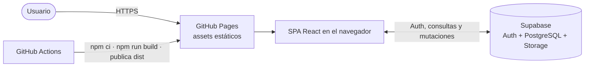

# Arquitectura — Dashboard Furthurr

Documentación canónica de arquitectura. Lee este archivo antes de cambiar límites entre módulos, integración con Supabase, routing o despliegue.

## Estado de sincronización

- Tecnología detectada: SPA web con React 19, TypeScript 6 y Vite 8; Supabase como servicio gestionado.
- Modo: `lite`.
- Commit base revisado: `81335b92bc1962a47c9c3bb963271c3667bc7b63` (2026-05-04). Es una referencia, no un baseline que incluya los cambios locales.
- Última actualización documental: 2026-10-16.
- Estado: **pendiente de baseline Git**. Al sincronizar había modificaciones locales en `AGENTS.md`, `specs/06-ui-ux-diseno.md` y `src/features/board/TaskDetailModal.tsx`; este contexto refleja el árbol de trabajo observado. No marcar como vigente contra `HEAD` hasta integrar esos cambios y refrescar la documentación.

## Contexto para IA

- **Sistema:** dashboard Kanban de una sola página, compilado como contenido estático y servido desde GitHub Pages. El cliente web usa directamente Supabase Auth y los datos de la aplicación (`src/App.tsx:1-40`, `src/lib/supabase.ts:1-10`); no hay servidor propio en este repositorio.
- **Estilo:** SPA React organizada por features (`auth`, `board`), con providers globales y hooks de TanStack Query para lecturas y mutaciones (`src/App.tsx:10-23`, `src/features/board/api.ts:1-29`). Los módulos de feature acceden a Supabase directamente; no se observa una capa backend ni repositorios separados.
- **Módulos y límites:** `src/main.tsx` monta la aplicación; `src/App.tsx` configura providers y rutas; `src/features/auth/` administra sesión y acceso; `src/features/board/` presenta el tablero y operaciones de tareas, comentarios y adjuntos; `src/lib/supabase.ts` crea el cliente; `src/types/` concentra tipos compartidos (`src/main.tsx:6-10`, `src/App.tsx:1-40`, `src/features/auth/AuthContext.tsx:16-63`, `src/features/board/BoardPage.tsx:30-53`, `src/types/index.ts:1-65`).
- **Datos y permisos:** `supabase-schema.sql` define tablas, triggers, políticas RLS, buckets y vistas (`supabase-schema.sql:10-30`, `supabase-schema.sql:117-168`, `supabase-schema.sql:349-424`). El cliente controla navegación y experiencia; las políticas de Supabase son el límite efectivo de acceso a datos.
- **Regla de dependencias observada:** las páginas de feature pueden usar sus hooks/API locales, tipos compartidos y el cliente en `src/lib/`; la inicialización y el routing viven en `App.tsx` (`src/App.tsx:1-40`, `src/features/board/api.ts:1-21`). No asumir una separación por capas que el código actual no implementa.
- **Fuentes de verdad:** `specs/` contiene la intención funcional y las decisiones de producto (`AGENTS.md:33-40`); `supabase-schema.sql` es el schema SQL de referencia según `AGENTS.md:68-70`; el código actual describe el comportamiento implementado. Las carpetas `.data/` y `.design/` documentan sus respectivos dominios sin reemplazar esas fuentes.

## 1. Contexto y alcance

El producto es un tablero Kanban con autenticación, consulta/edición de tareas, creación/eliminación de comentarios y carga/eliminación de adjuntos (`src/App.tsx:24-37`, `src/features/board/BoardPage.tsx:297-370`, `src/features/board/commentsApi.ts:27-74`, `src/features/board/attachmentsApi.ts:24-95`). Los usuarios acceden desde un navegador a la SPA alojada en GitHub Pages; las operaciones dinámicas van del navegador a Supabase. La implementación y las instrucciones del proyecto indican que no hay servidor propio (`AGENTS.md:18-22`).

## 2. Restricciones y decisiones estructurales

- `vite.config.ts` fija `base: '/dashboardFurthurr/'` (`vite.config.ts:6-13`); la aplicación usa `HashRouter` y las rutas implementadas son `/login`, `/register`, `/auth/callback` y `/board` (`src/App.tsx:1-37`). La raíz redirige a `/board` (`src/App.tsx:24-27`).
- GitHub Pages no es un servidor de aplicación ni se documenta un rewrite de rutas; las instrucciones de proyecto especifican que Pages no reescribe las rutas SPA (`AGENTS.md:42-44`). El routing hash evita depender de ese rewrite (`src/App.tsx:1-2`).
- El build necesita `VITE_SUPABASE_URL` y `VITE_SUPABASE_PUBLISHABLE_KEY` (`src/lib/supabase.ts:3-10`); `.github/workflows/deploy.yml` los toma de secretos del workflow (`.github/workflows/deploy.yml:33-42`). Nunca documentar valores ni añadir credenciales al cliente.
- La autorización debe permanecer respaldada por RLS en Supabase (`supabase-schema.sql:164-168`, `supabase-schema.sql:198-234`); ocultar una acción o proteger una ruta en React no sustituye políticas de base de datos.
- El flujo de despliegue comprobado en `.github/workflows/deploy.yml` usa Node 20, `npm ci`, `npm run build`, carga `dist` y despliega a GitHub Pages desde `main` o mediante ejecución manual (`.github/workflows/deploy.yml:1-53`).

## 3. Bloques de construcción

| Bloque | Responsabilidad | Evidencia |
| --- | --- | --- |
| Entrada y composición | Monta React, providers, `HashRouter` y rutas | `src/main.tsx:6-10`, `src/App.tsx:1-40` |
| Auth | Sesión de Supabase, perfil y acceso protegido | `src/features/auth/AuthContext.tsx:16-63`, `src/features/auth/ProtectedRoute.tsx:8-24` |
| Board | Columnas, tarjetas, modales, ordenamiento y mutaciones de tareas | `src/features/board/BoardPage.tsx:30-53`, `src/features/board/api.ts:5-29`, `src/features/board/BoardPage.tsx:97-147` |
| Comentarios y adjuntos | Hooks/API asociados a tareas y Storage para ficheros | `src/features/board/commentsApi.ts:5-24`, `src/features/board/attachmentsApi.ts:5-22`, `src/features/board/attachmentsApi.ts:24-72` |
| Cliente Supabase | Crea el cliente con las variables de entorno públicas requeridas | `src/lib/supabase.ts:1-10` |
| Tipos compartidos | Roles, estados, prioridades y modelos de perfil/tarea/comentario/adjunto | `src/types/index.ts:1-65` |
| Servicio gestionado | Auth, persistencia, Storage y políticas RLS | `supabase-schema.sql:10-168`, `supabase-schema.sql:349-424` |

TanStack Query está configurado en `src/App.tsx` con `staleTime` de cinco minutos y un reintento (`src/App.tsx:10-17`); las queries de tareas, comentarios y adjuntos se definen junto a la feature correspondiente (`src/features/board/api.ts:24-29`, `src/features/board/commentsApi.ts:19-24`, `src/features/board/attachmentsApi.ts:16-22`). El tablero permite mover tareas con dnd-kit y dispone de sensor de teclado (`src/features/board/BoardPage.tsx:56-65`, `src/features/board/BoardPage.tsx:97-147`).

## 4. Flujos principales

### Inicio y acceso

1. `AuthProvider` recupera la sesión de Supabase y escucha cambios de autenticación (`src/features/auth/AuthContext.tsx:38-63`).
2. Con una sesión, obtiene el perfil desde `profiles`; sin sesión, limpia el estado (`src/features/auth/AuthContext.tsx:22-36`, `src/features/auth/AuthContext.tsx:43-48`).
3. `ProtectedRoute` muestra carga, redirige a `/login` sin sesión o renderiza la vista protegida (`src/features/auth/ProtectedRoute.tsx:8-24`).
4. `BoardPage` consulta tareas y, al seleccionar una, comentarios y adjuntos mediante hooks de TanStack Query que llaman a Supabase (`src/features/board/BoardPage.tsx:30-53`, `src/features/board/api.ts:5-29`, `src/features/board/commentsApi.ts:5-24`, `src/features/board/attachmentsApi.ts:5-22`).

### Datos del tablero

La UI invoca mutaciones locales de la feature `board`; estas ejecutan consultas `select`, `insert`, `update` o `delete` sobre Supabase y luego invalidan las claves de TanStack Query (`src/features/board/api.ts:31-164`, `src/features/board/commentsApi.ts:27-74`, `src/features/board/attachmentsApi.ts:24-95`). El esquema y las políticas correspondientes están en `supabase-schema.sql`; contratos y permisos de producto también se describen en `specs/04-modelo-datos.md` y `specs/05-auth-roles-permisos.md`.

## 5. Despliegue y operación

El workflow `.github/workflows/deploy.yml` compila la SPA en GitHub Actions y publica `dist` en Pages (`.github/workflows/deploy.yml:17-53`). Para trabajo local, `npm run dev` inicia Vite, `npm run build` ejecuta TypeScript y Vite, `npm run lint` ejecuta ESLint y `npm run preview` sirve el build local (`package.json:6-10`). La configuración de Pages y el prefijo de URL están acoplados al `base` de Vite y al `HashRouter` (`vite.config.ts:6-13`, `src/App.tsx:1-37`).

## 6. Riesgos y límites conocidos

- La disponibilidad del producto depende de GitHub Pages y Supabase; el repositorio no contiene backend propio ni una estrategia local de persistencia alternativa.
- Las credenciales de compilación son requisito del despliegue (`.github/workflows/deploy.yml:33-37`). Se documentan solo los nombres de variables; los valores se mantienen en el entorno/secretos.
- El schema SQL agrupa políticas RLS y políticas de Storage (`supabase-schema.sql:161-168`, `supabase-schema.sql:359-402`). Cualquier cambio de autorización debe contrastarse con `specs/05-auth-roles-permisos.md` y validarse en Supabase; la UI por sí sola no es evidencia de permiso efectivo.
- No hay evidencia en las rutas de acceso consultadas de uso activo de Supabase Realtime; no asumir sincronización en tiempo real (`src/App.tsx:1-55`, `src/features/board/api.ts:1-165`, `package.json:12-23`).

## Decisiones

- [ADR 0001: SPA estática con Supabase](decisions/0001-spa-estatica-supabase.md)
- [ADR 0002: HashRouter para GitHub Pages](decisions/0002-hashrouter-github-pages.md)

## Índice de documentación relacionada

- [Datos y persistencia](../.data/README.md)
- [Sistema visual](../.design/README.md)
- [Mapa de proyecto](../.navigator/ai-context.md)
- [Especificaciones funcionales](../specs/README.md)
