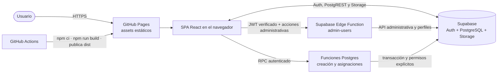

# Arquitectura — Dashboard Furthurr

Documentación canónica de arquitectura. Lee este archivo antes de cambiar límites entre módulos, integración con Supabase, routing o despliegue.

## Estado de sincronización

- Tecnología detectada: SPA React 19/TypeScript 6/Vite 8, Supabase Auth/PostgreSQL/Storage, Edge Function administrativa y RPCs Postgres.
- Modo: `lite`.
- Commit base revisado: `81335b92bc1962a47c9c3bb963271c3667bc7b63` (2026-05-04). Es una referencia, no un baseline que incluya los cambios locales.
- Última actualización documental: 2026-10-20, revisión focalizada de administración de usuarios y asignaciones.
- HEAD observado: `1d3069d904bc9e1dc6a7363d3967ad4c2709dace`. **No es un commit de sincronización:** los cambios de producto y `supabase/` siguen sin commit. Se conserva la referencia histórica anterior; esta revisión describe el árbol de trabajo, pendiente de baseline Git.
- Alcance: administración de cuentas y responsables. Durante la revisión aparecieron `ProfilePage` y `AccountMenu`; solo se localizan sus cambios de navegación, sin certificar su flujo completo ni nuevas pruebas.

## Contexto para IA

- **Sistema:** dashboard Kanban estático en GitHub Pages; datos/Auth/Storage mediante Supabase JS. El repositorio también contiene backend desplegable en Supabase: `admin-users` para operaciones privilegiadas y funciones Postgres para tareas/asignaciones. No hay servidor de aplicación independiente ni SSR (`src/App.tsx:19-42`, `supabase/functions/admin-users/index.ts:13-80`).
- **Estilo:** features cliente `auth`, `board` y `users`, providers globales y TanStack Query. Lecturas/mutaciones ordinarias acceden al SDK; administración usa `functions.invoke` y asignaciones usan `rpc`. No se documenta una capa de repositorios inexistente (`src/features/users/api.ts`, `src/features/board/api.ts`).
- **Módulos y límites:** `auth` mantiene sesión/perfil y exige cuenta activa; `users` presenta administración; `board` compone tareas, adjuntos, comentarios y `AssigneePicker`; `src/types/` define `Profile`, `AssigneeProfile` y modelos. El código privilegiado vive en `supabase/functions/`, no en el bundle web (`src/features/auth/ProtectedRoute.tsx:9-34`, `src/features/board/assigneesApi.ts`).
- **Datos y permisos:** SQL bootstrap en `supabase-schema.sql`; cambios incrementales en `supabase/migrations/`. RLS/grants y comprobaciones explícitas en Edge/RPC son la frontera efectiva. `is_active` se consulta en base de datos, no se confía en metadata JWT para autorizar. Los invitados activos pueden gestionar responsables de cualquier tarea, no crear tareas ni editar sus campos (`supabase/migrations/202610190001_user_administration.sql:4-56`, `supabase/migrations/202610200001_task_assignments.sql:7-76`).
- **Regla de dependencias observada:** las páginas de feature pueden usar sus hooks/API locales, tipos compartidos y el cliente en `src/lib/`; la inicialización y el routing viven en `App.tsx` (`src/App.tsx:1-40`, `src/features/board/api.ts:1-21`). No asumir una separación por capas que el código actual no implementa.
- **Fuentes de verdad:** `specs/` contiene la intención funcional y las decisiones de producto (`AGENTS.md:33-40`); `supabase-schema.sql` es el schema SQL de referencia según `AGENTS.md:68-70`; el código actual describe el comportamiento implementado. Las carpetas `.data/` y `.design/` documentan sus respectivos dominios sin reemplazar esas fuentes.

## 1. Contexto y alcance

El tablero añade administración de cuentas y asignación múltiple de responsables. La SPA sigue alojada en GitHub Pages; las operaciones dinámicas se ejecutan en servicios gestionados de Supabase. La frase histórica «sin servidor propio» significa que no hay infraestructura de servidor independiente: **no implica ausencia de código backend** (`src/features/users/UsersPage.tsx`, `supabase/functions/admin-users/index.ts`, `supabase/migrations/202610200001_task_assignments.sql`).

## 2. Restricciones y decisiones estructurales

- `HashRouter` y base `/dashboardFurthurr/` se conservan. `/board` requiere sesión y perfil activo; `/users` exige además `admin`. `/register` es una redirección de compatibilidad a `/users`, no registro público. `/login` y `/auth/callback` completan el routing (`src/App.tsx:24-37`, `src/features/auth/ProtectedRoute.tsx:21-32`).
- Cambio concurrente observado: `src/App.tsx` añade `/profile` protegido y la cabecera del tablero usa `AccountMenu`, que ofrece «Usuarios» a admin y «Perfil»/cierre de sesión. El detalle de edición de perfil no forma parte de esta sincronización focalizada (`src/shared/ui/AccountMenu.tsx:20-35`).
- GitHub Pages no es un servidor de aplicación ni se documenta un rewrite de rutas; las instrucciones de proyecto especifican que Pages no reescribe las rutas SPA (`AGENTS.md:42-44`). El routing hash evita depender de ese rewrite (`src/App.tsx:1-2`).
- El build necesita `VITE_SUPABASE_URL` y `VITE_SUPABASE_PUBLISHABLE_KEY` (`src/lib/supabase.ts:3-10`); `.github/workflows/deploy.yml` los toma de secretos del workflow (`.github/workflows/deploy.yml:33-42`). Nunca documentar valores ni añadir credenciales al cliente.
- La autorización debe permanecer respaldada por RLS en Supabase (`supabase-schema.sql:164-168`, `supabase-schema.sql:198-234`); ocultar una acción o proteger una ruta en React no sustituye políticas de base de datos.
- El flujo de despliegue comprobado en `.github/workflows/deploy.yml` usa Node 20, `npm ci`, `npm run build`, carga `dist` y despliega a GitHub Pages desde `main` o mediante ejecución manual (`.github/workflows/deploy.yml:1-53`).

## 3. Bloques de construcción

| Bloque | Responsabilidad | Evidencia |
| --- | --- | --- |
| Entrada y composición | Monta React, providers, `HashRouter` y rutas | `src/main.tsx:6-10`, `src/App.tsx:1-40` |
| Auth | Sesión, perfil activo, limpieza de caché y refresco a los 30 s/al recuperar foco | `src/features/auth/AuthContext.tsx:27-98`, `src/features/auth/ProtectedRoute.tsx:9-34` |
| Users | Listado paginado, alta confirmada, nombre, contraseña y estado; sin edición de roles en UI | `src/features/users/UsersPage.tsx`, `src/features/users/api.ts` |
| Board | Columnas, tarjetas, modales, ordenamiento y mutaciones de tareas | `src/features/board/BoardPage.tsx:30-53`, `src/features/board/api.ts:5-29`, `src/features/board/BoardPage.tsx:97-147` |
| Comentarios y adjuntos | Hooks/API asociados a tareas y Storage para ficheros | `src/features/board/commentsApi.ts:5-24`, `src/features/board/attachmentsApi.ts:5-22`, `src/features/board/attachmentsApi.ts:24-72` |
| Cliente Supabase | Crea el cliente con las variables de entorno públicas requeridas | `src/lib/supabase.ts:1-10` |
| Tipos compartidos | Roles, estados, prioridades y modelos de perfil/tarea/comentario/adjunto | `src/types/index.ts:1-65` |
| Servicio gestionado | Auth, persistencia, Storage y políticas RLS | `supabase-schema.sql:10-168`, `supabase-schema.sql:349-424` |
| Administración privilegiada | Verifica JWT con `auth.getUser`, exige admin activo y ejecuta API administrativa | `supabase/functions/admin-users/index.ts:20-72`, `supabase/functions/admin-users/validation.ts` |
| Funciones transaccionales | Alta de tarea con responsables y sustitución completa de asignaciones | `supabase/migrations/202610200001_task_assignments.sql:7-76` |

TanStack Query está configurado en `src/App.tsx` con `staleTime` de cinco minutos y un reintento (`src/App.tsx:10-17`); las queries de tareas, comentarios y adjuntos se definen junto a la feature correspondiente (`src/features/board/api.ts:24-29`, `src/features/board/commentsApi.ts:19-24`, `src/features/board/attachmentsApi.ts:16-22`). El tablero permite mover tareas con dnd-kit y dispone de sensor de teclado (`src/features/board/BoardPage.tsx:56-65`, `src/features/board/BoardPage.tsx:97-147`).

## 4. Flujos principales

### Inicio y acceso

1. `AuthProvider` recupera la sesión de Supabase y escucha cambios de autenticación (`src/features/auth/AuthContext.tsx:38-63`).
2. Con una sesión, obtiene el perfil desde `profiles`; sin sesión, limpia el estado (`src/features/auth/AuthContext.tsx:22-36`, `src/features/auth/AuthContext.tsx:43-48`).
3. `ProtectedRoute` redirige sin sesión, bloquea perfiles ausentes/inactivos y comprueba `adminOnly`. El perfil se refresca cada 30 segundos y al recuperar foco; se descartan respuestas de sesiones anteriores y se limpia la caché al cambiar identidad o perder acceso (`src/features/auth/ProtectedRoute.tsx:21-32`, `src/features/auth/AuthContext.tsx:27-98`).
4. `BoardPage` consulta tareas y, al seleccionar una, comentarios y adjuntos mediante hooks de TanStack Query que llaman a Supabase (`src/features/board/BoardPage.tsx:30-53`, `src/features/board/api.ts:5-29`, `src/features/board/commentsApi.ts:5-24`, `src/features/board/attachmentsApi.ts:5-22`).

### Datos del tablero

La creación usa `create_task_with_assignees`: deriva propietario de `auth.uid()`, permite `admin`/`usuario` activos y guarda tarea + responsables de forma atómica. Después se suben adjuntos; un fallo parcial de archivos conserva la tarea. `set_task_assignees` permite a cualquier cuenta activa reemplazar responsables con bloqueo de fila y validación de destinos; `[]` retira todos. Se revocan escrituras cliente directas a `task_assignees`. Las demás mutaciones de tarea, comentarios y adjuntos conservan sus políticas (`src/features/board/api.ts`, `supabase/migrations/202610200001_task_assignments.sql:5-76`).

### Administración de cuentas

`UsersPage` llama a `admin-users`. La función verifica el token y el perfil admin activo antes de procesar cualquier acción. El alta usa `email_confirm: true` y fuerza rol `usuario`/estado activo; un fallo del perfil intenta compensarse eliminando el alta incompleta. `rename` solo cambia `profiles.full_name`; contraseñas se gestionan en Auth. Desactivar modifica `is_active`, no borra contenido ni invalida criptográficamente los JWT. RLS bloquea solicitudes nuevas con tokens antiguos; no retira archivos ya descargados ni URLs firmadas ya emitidas (`supabase/functions/admin-users/index.ts:24-72`, `supabase/migrations/202610190001_user_administration.sql`).

## 5. Despliegue y operación

El workflow `.github/workflows/deploy.yml` compila la SPA en GitHub Actions y publica `dist` en Pages (`.github/workflows/deploy.yml:17-53`). Para trabajo local, `npm run dev` inicia Vite, `npm run build` ejecuta TypeScript y Vite, `npm run lint` ejecuta ESLint y `npm run preview` sirve el build local (`package.json:6-10`). La configuración de Pages y el prefijo de URL están acoplados al `base` de Vite y al `HashRouter` (`vite.config.ts:6-13`, `src/App.tsx:1-37`).

Ese workflow **no despliega SQL ni Edge Functions**. En instalaciones existentes se aplican las migraciones en orden, se despliega `admin-users` y se deshabilita el registro público de Auth según [la guía operativa](../supabase/README.md). No reejecutar el bootstrap completo sobre una BD existente. `verify_jwt = false` del gateway no significa endpoint público: la verificación de token y permisos está dentro de la función; las claves privilegiadas solo viven en el entorno servidor (`supabase/config.toml`, `supabase/functions/admin-users/index.ts:17-28`).

## 6. Riesgos y límites conocidos

- La disponibilidad depende de GitHub Pages y Supabase, incluidas Edge Functions y RPCs. No se observó persistencia local alternativa.
- Las credenciales de compilación son requisito del despliegue (`.github/workflows/deploy.yml:33-37`). Se documentan solo los nombres de variables; los valores se mantienen en el entorno/secretos.
- El schema SQL agrupa políticas RLS y políticas de Storage (`supabase-schema.sql:161-168`, `supabase-schema.sql:359-402`). Cualquier cambio de autorización debe contrastarse con `specs/05-auth-roles-permisos.md` y validarse en Supabase; la UI por sí sola no es evidencia de permiso efectivo.
- No hay evidencia en las rutas de acceso consultadas de uso activo de Supabase Realtime; no asumir sincronización en tiempo real (`src/App.tsx:1-55`, `src/features/board/api.ts:1-165`, `package.json:12-23`).
- Las sustituciones concurrentes de responsables se serializan; prevalece el último conjunto guardado, sin resolución de conflictos del borrador. El código no promete revocar sesiones al cambiar contraseñas ni eliminar enlaces firmados al desactivar cuentas.

## Evidencia de implementación y límites de esta revisión

En esta sesión, antes de la sincronización documental, se registraron 79 pruebas Vitest, 9 pruebas Deno de `admin-users`, build/lint correctos y aviso de bundle superior a 500 kB. Las pruebas SQL `supabase/tests/user_access.sql` y `supabase/tests/task_assignments.sql` se ejecutaron sobre Supabase con `ROLLBACK`. Chromium comprobó creación/detalle/asignaciones a 360/768/1440 px con respuestas simuladas. Se registró aplicación de migraciones y despliegue de la función; **no se volvió a operar el remoto durante esta revisión documental**, ni se certifica publicación en GitHub Pages, auditoría de seguridad o accesibilidad completa.

## Decisiones

- [ADR 0001: SPA estática con Supabase](decisions/0001-spa-estatica-supabase.md)
- [ADR 0002: HashRouter para GitHub Pages](decisions/0002-hashrouter-github-pages.md)

## Índice de documentación relacionada

- [Datos y persistencia](../.data/README.md)
- [Sistema visual](../.design/README.md)
- [Mapa de proyecto](../.navigator/ai-context.md)
- [Especificaciones funcionales](../specs/README.md)
