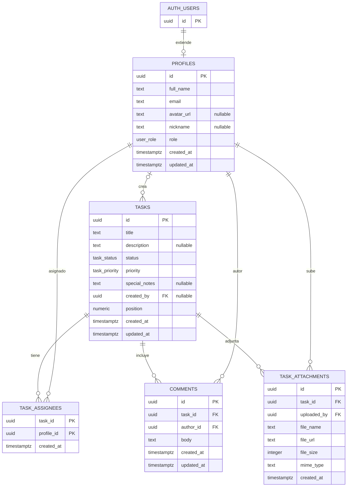

# Schema de persistencia Supabase

La base de datos es PostgreSQL gestionado fuera de la SPA. El archivo local `supabase-schema.sql` define enums, tablas, relaciones, triggers, políticas, buckets, vistas y grants. Este documento describe ese archivo; no verifica el estado aplicado en un proyecto Supabase.

## Modelo relacional

Fuente: `supabase-schema.sql:21-30`, `supabase-schema.sql:39-64`, `supabase-schema.sql:73-98`.

## Enumeraciones y reglas de persistencia

- `user_role`: `admin`, `usuario`, `invitado` (`supabase-schema.sql:10`).
- `task_status`: `backlog`, `por_hacer`, `haciendo`, `en_revision`, `finalizadas` (`supabase-schema.sql:12`).
- `task_priority`: `urgente`, `alta`, `normal`, `baja` (`supabase-schema.sql:14`).
- `handle_updated_at()` actualiza `updated_at` en perfiles, tareas y comentarios (`supabase-schema.sql:117-137`).
- `handle_new_user()` crea el perfil tras insertar en `auth.users` y asigna inicialmente el rol `usuario` (`supabase-schema.sql:142-158`).
- Hay índices por estado, prioridad y creador de tarea, así como por tarea/autor de comentario y tarea de adjunto (`supabase-schema.sql:103-111`).

## Políticas RLS declaradas

RLS está habilitado para las cinco tablas de la aplicación (`supabase-schema.sql:161-168`). La siguiente tabla resume las condiciones escritas en SQL, no el resultado de una auditoría ni la configuración realmente desplegada.

| Recurso | Operación | Condición resumida | Fuente |
| --- | --- | --- | --- |
| `profiles` | select | `using (true)`; el grant explícito listado es para `authenticated` | `supabase-schema.sql:174-177`, `supabase-schema.sql:445-446` |
| `profiles` | update | usuario dueño o perfil con rol admin | `supabase-schema.sql:179-192` |
| `tasks` | select | `auth.role() = 'authenticated'` | `supabase-schema.sql:198-201` |
| `tasks` | insert | perfil con rol admin o usuario | `supabase-schema.sql:203-212` |
| `tasks` | update/delete | creador o admin | `supabase-schema.sql:214-234` |
| `task_assignees` | select/insert/delete | authenticated; admin/usuario para insert; admin/creador para delete | `supabase-schema.sql:240-267` |
| `comments` | select/insert/update/delete | authenticated para lectura; admin/usuario para crear; autor/admin para update/delete | `supabase-schema.sql:273-308` |
| `task_attachments` | select/insert/delete | authenticated para lectura; admin/usuario para insertar metadata; cargador/admin/creador para borrar metadata | `supabase-schema.sql:314-342` |

Los comentarios de algunas policies de Storage describen roles distintos de lo que comprueba su predicado. El predicado SQL es la evidencia de esta tabla de Storage; no se interpreta aquí la intención de seguridad. Contrastar con `specs/05-auth-roles-permisos.md` y solicitar revisión de seguridad antes de cambiarlo.

## Storage

| Bucket | Visibilidad declarada | Operaciones/policies del SQL | Fuente |
| --- | --- | --- | --- |
| `avatars` | Público | Lectura pública; upload autenticado; update por propietario según primer segmento del nombre | `supabase-schema.sql:348-351`, `supabase-schema.sql:362-381` |
| `task-attachments` | Privado (`public = false`) | Select autenticado; insert autenticado; delete si el primer segmento del path corresponde al usuario | `supabase-schema.sql:353-356`, `supabase-schema.sql:383-402` |

El cliente de adjuntos usa un nombre plano (UUID más extensión) y `getPublicUrl`; el schema declara bucket privado y exige convención de carpeta de usuario para borrar. Son contratos que no coinciden completamente con el uso actual; ver D-02 y D-04.

## Vistas

- `tasks_with_assignees`: agrega datos de perfiles asignados (`supabase-schema.sql:408-424`).
- `tasks_with_stats`: calcula conteos distintos de comentarios y adjuntos (`supabase-schema.sql:426-435`).
- Las consultas de `src/features/board/api.ts` revisadas no usan estas vistas (`src/features/board/api.ts:5-21`).

## Coherencia referencial pendiente

`comments.author_id` y `task_attachments.uploaded_by` se declaran `NOT NULL`, pero sus claves foráneas usan `ON DELETE SET NULL` (`supabase-schema.sql:73-76`, `supabase-schema.sql:89-93`). Esa combinación se registra como deuda D-01; no se modifica el SQL en esta operación.
