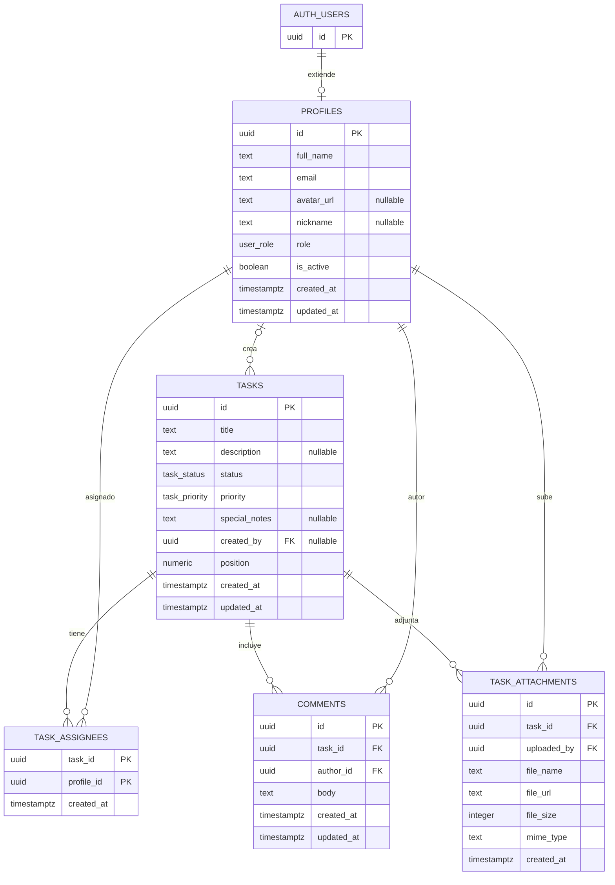

# Schema de persistencia Supabase

La persistencia es PostgreSQL gestionado fuera de la SPA. `supabase-schema.sql` es el bootstrap completo; `supabase/migrations/` contiene los cambios incrementales. Se documenta el estado final tras **ambas** migraciones, no solo las policies/grants históricos al principio del bootstrap. Esta revisión no consulta ni modifica el remoto; la evidencia previa de aplicación está acotada en [README](README.md#evidencia-y-límites).

## Modelo relacional

Fuente: `supabase-schema.sql:21-30`, `supabase-schema.sql:39-64`, `supabase-schema.sql:73-98`.

## Enumeraciones y reglas de persistencia

- `user_role`: `admin`, `usuario`, `invitado` (`supabase-schema.sql:10`).
- `task_status`: `backlog`, `por_hacer`, `haciendo`, `en_revision`, `finalizadas` (`supabase-schema.sql:12`).
- `task_priority`: `urgente`, `alta`, `normal`, `baja` (`supabase-schema.sql:14`).
- `handle_updated_at()` actualiza `updated_at` en perfiles, tareas y comentarios (`supabase-schema.sql:117-137`).
- `handle_new_user()` crea el perfil tras insertar en `auth.users` y asigna inicialmente el rol `usuario` (`supabase-schema.sql:142-158`).
- `profiles.is_active` es obligatorio/default `true`; la migración activa las cuentas existentes sin modificar sus roles (`supabase/migrations/202610190001_user_administration.sql:4`). No es un flag de borrado ni un ban en Auth.
- Hay índices por estado, prioridad y creador de tarea, así como por tarea/autor de comentario y tarea de adjunto (`supabase-schema.sql:103-111`).

## Políticas RLS declaradas

RLS está habilitado para las cinco tablas de la aplicación (`supabase-schema.sql:161-168`). La siguiente tabla resume las condiciones escritas en SQL, no el resultado de una auditoría ni la configuración realmente desplegada.

| Recurso | Operación | Condición resumida | Fuente |
| --- | --- | --- | --- |
| `profiles` | select | cuenta activa lee perfiles; cuenta inactiva autenticada puede leer únicamente el propio para mostrar bloqueo | `supabase/migrations/202610190001_user_administration.sql:18-38` |
| `profiles` | update cliente | conserva RLS dueño/admin, exige cuenta activa y solo concede columnas `full_name`, `avatar_url`, `nickname`; no `role` ni `is_active` | `supabase-schema.sql:179-193`, `supabase/migrations/202610190001_user_administration.sql:14-16`, `:33-35` |
| `tasks` | select/insert/update/delete | gate restrictivo de cuenta activa AND políticas anteriores; crear admin/usuario, modificar/borrar creador/admin según SQL | `supabase-schema.sql:198-235`, `supabase/migrations/202610190001_user_administration.sql:24-30` |
| `task_assignees` | select | autenticado activo por RLS | `supabase-schema.sql:241-244`, `supabase/migrations/202610190001_user_administration.sql:24-30` |
| `task_assignees` | escrituras cliente | INSERT/UPDATE/DELETE revocados; los predicados históricos no conceden permisos por sí solos | `supabase/migrations/202610200001_task_assignments.sql:5` |
| `task_assignees` | RPC | cuenta activa de cualquier rol sustituye responsables; no obtiene permiso para editar la tarea | `supabase/migrations/202610200001_task_assignments.sql:7-45` |
| `comments` | select/insert/update/delete | gate activo AND políticas anteriores: lectura autenticada, alta admin/usuario, update/delete autor/admin | `supabase-schema.sql:273-309`, `supabase/migrations/202610190001_user_administration.sql:24-30` |
| `task_attachments` | select/insert/delete | gate activo AND políticas anteriores de lectura/carga/eliminación de metadata | `supabase-schema.sql:314-343`, `supabase/migrations/202610190001_user_administration.sql:24-30` |

Los comentarios de algunas policies de Storage describen roles distintos de lo que comprueba su predicado. El predicado SQL es la evidencia de esta tabla de Storage; no se interpreta aquí la intención de seguridad. Contrastar con `specs/05-auth-roles-permisos.md` y solicitar revisión de seguridad antes de cambiarlo.

### Funciones y autorización explícita

`is_active_account()` es `SECURITY DEFINER`, `STABLE`, con `search_path = ''`; consulta `profiles` por `auth.uid()` sin recursión RLS. Se concede a roles de API para evaluar policies, no permite escoger otra identidad (`supabase/migrations/202610190001_user_administration.sql:7-12`).

Las RPCs de asignación son `SECURITY DEFINER` con path vacío y ejecución solo para `authenticated`; verifican identidad/estado explícitamente. `set_task_assignees` bloquea la fila de tarea y perfiles destino; deduplica, valida y sustituye atómicamente el conjunto. `create_task_with_assignees` exige rol admin/usuario, obtiene el creador de la sesión y usa bloqueo asesor por estado para calcular posición; un error de asignaciones revierte la tarea. Los invitados solo pueden ejecutar la sustitución, no el alta (`supabase/migrations/202610200001_task_assignments.sql:7-76`).

## Storage

| Bucket | Visibilidad declarada | Operaciones/policies del SQL | Fuente |
| --- | --- | --- | --- |
| `avatars` | Público | Lectura pública; upload autenticado; update por propietario según primer segmento del nombre | `supabase-schema.sql:348-351`, `supabase-schema.sql:362-381` |
| `task-attachments` | Privado (`public = false`) | Select autenticado; insert autenticado; delete si el primer segmento del path corresponde al usuario | `supabase-schema.sql:353-356`, `supabase-schema.sql:383-402` |

A esas policies se añaden restricciones de cuenta activa para los buckets gestionados. Lecturas de avatares públicos permanecen públicas; las lecturas de adjuntos privados y las escrituras en ambos buckets requieren estado activo. No se revocan archivos descargados ni URLs firmadas previas (`supabase/migrations/202610190001_user_administration.sql:40-52`).

El cliente sigue cargando nombre plano y almacenando `getPublicUrl`; el bucket privado y la convención de carpeta para borrar no coinciden completamente con ese uso. Las miniaturas ahora extraen el path y usan URLs firmadas; esto no cierra D-02/D-04 en el resto del flujo (`src/features/board/attachmentsApi.ts:30-95`, `:111-157`).

## Vistas

- `tasks_with_assignees`: agrega datos de perfiles asignados (`supabase-schema.sql:408-424`).
- `tasks_with_stats`: calcula conteos distintos de comentarios y adjuntos (`supabase-schema.sql:426-435`).
- Las consultas de `src/features/board/api.ts` revisadas no usan estas vistas (`src/features/board/api.ts:5-21`).
- Ambas vistas se alteran con `security_invoker = true` para respetar los permisos/RLS del llamador (`supabase/migrations/202610190001_user_administration.sql:54-56`).

## Coherencia referencial pendiente

`comments.author_id` y `task_attachments.uploaded_by` se declaran `NOT NULL`, pero sus claves foráneas usan `ON DELETE SET NULL` (`supabase-schema.sql:73-76`, `supabase-schema.sql:89-93`). Esa combinación se registra como deuda D-01; no se modifica el SQL en esta operación.
