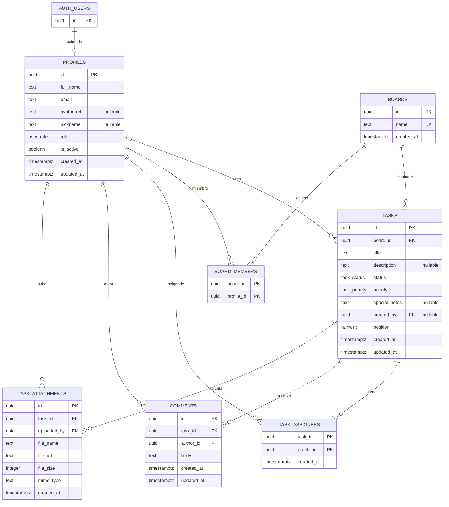

# Schema de persistencia Supabase

La persistencia es PostgreSQL gestionado fuera de la SPA. `supabase-schema.sql` es el bootstrap completo; `supabase/migrations/` contiene los cambios incrementales para instalaciones existentes. Este documento recoge el contrato de tableros del bootstrap y la migración `202610210001_boards.sql`; no afirma que la secuencia nueva esté aplicada remotamente.

## Modelo relacional

Fuente: `supabase-schema.sql` y `supabase/migrations/202610210001_boards.sql:4-22`.

## Enumeraciones y reglas de persistencia

- `user_role`: `admin`, `usuario`, `invitado` (`supabase-schema.sql:10`).
- `task_status`: `backlog`, `por_hacer`, `haciendo`, `en_revision`, `finalizadas` (`supabase-schema.sql:12`).
- `task_priority`: `urgente`, `alta`, `normal`, `baja` (`supabase-schema.sql:14`).
- `handle_updated_at()` actualiza `updated_at` en perfiles, tareas y comentarios (`supabase-schema.sql:117-137`).
- `handle_new_user()` crea el perfil tras insertar en `auth.users` y asigna inicialmente el rol `usuario` (`supabase-schema.sql:142-158`).
- `profiles.is_active` es obligatorio/default `true`; la migración activa las cuentas existentes sin modificar sus roles (`supabase/migrations/202610190001_user_administration.sql:4`). No es un flag de borrado ni un ban en Auth.
- Hay índices por estado, prioridad y creador de tarea, así como por tarea/autor de comentario y tarea de adjunto (`supabase-schema.sql:103-111`).

## Políticas RLS declaradas

RLS está habilitado para las tablas de aplicación. La siguiente tabla resume las condiciones del bootstrap junto con las restricciones de `202610210001_boards.sql`; no certifica configuración remota.

| Recurso | Operación | Condición resumida | Fuente |
| --- | --- | --- | --- |
| `profiles` | select | cuenta activa lee perfiles; cuenta inactiva autenticada puede leer únicamente el propio para mostrar bloqueo | `supabase/migrations/202610190001_user_administration.sql:18-38` |
| `profiles` | update cliente | conserva RLS dueño/admin, exige cuenta activa y solo concede columnas `full_name`, `avatar_url`, `nickname`; no `role` ni `is_active` | `supabase-schema.sql:179-193`, `supabase/migrations/202610190001_user_administration.sql:14-16`, `:33-35` |
| `tasks` | select | autenticado activo por RLS | `supabase-schema.sql:199-202`, `supabase/migrations/202610190001_user_administration.sql:24-30` |
| `boards` | select | Admin activo ve todos; otras cuentas activas solo los tableros de `board_members` | `supabase/migrations/202610210001_boards.sql:24-49` |
| `boards` | insert | Solo admin activo; nombre único (case-insensitive), recortado de 1–120 caracteres | `supabase/migrations/202610210001_boards.sql:4-9,47-48` |
| `board_members` | select / escritura | Solo admin lee; RPC admin sustituye perfiles existentes/activos. Sin alta directa cliente | `supabase/migrations/202610210001_boards.sql:42-49,63-80` |
| `tasks` | insert | requiere rol `admin`/`usuario` activo; el propietario lo fija la RPC, no el cliente | `supabase-schema.sql:204-213`, `supabase/migrations/202610200001_task_assignments.sql:47-76` |
| `tasks`, `task_assignees`, `comments`, `task_attachments` | todas | Policy restrictiva exige membresía del tablero de la tarea o admin activo. Ser responsable no otorga acceso | `supabase/migrations/202610210001_boards.sql:51-59` |
| `tasks` | update | **edición compartida dentro de tablero accesible**: cualquier cuenta autenticada activa puede actualizar cualquier tarea que puede consultar; `board_id` además se protege por policy/grants/RPC | `supabase-schema.sql:215-221`, `supabase/migrations/202610200002_shared_task_editing.sql:9-14`, `supabase/migrations/202610210001_boards.sql:51-53` |
| `tasks` | update (columnas cliente) | solo `title`, `description`, `status`, `priority`, `position`; `created_by` no es escribible | `supabase-schema.sql:448-450`, `supabase/migrations/202610200002_shared_task_editing.sql:19-21` |
| `tasks` | delete | creador o admin; gate restrictivo de cuenta activa | `supabase-schema.sql:223-232`, `supabase/migrations/202610190001_user_administration.sql:24-30` |
| `task_assignees` | select | autenticado activo por RLS | `supabase-schema.sql:241-244`, `supabase/migrations/202610190001_user_administration.sql:24-30` |
| `task_assignees` | escrituras cliente | INSERT/UPDATE/DELETE revocados; los predicados históricos no conceden permisos por sí solos | `supabase/migrations/202610200001_task_assignments.sql:5` |
| `task_assignees` | RPC | cuenta activa de cualquier rol con acceso al tablero sustituye responsables; la RPC no edita la tarea | `supabase/migrations/202610200001_task_assignments.sql:7-45`, `supabase/migrations/202610210001_boards.sql:82-92` |
| `comments` | select/insert/update/delete | gate activo AND políticas anteriores: lectura autenticada, alta admin/usuario, update/delete autor/admin | `supabase-schema.sql:273-309`, `supabase/migrations/202610190001_user_administration.sql:24-30` |
| `task_attachments` | select/insert/delete | gate activo AND políticas anteriores de lectura/carga/eliminación de metadata | `supabase-schema.sql:314-343`, `supabase/migrations/202610190001_user_administration.sql:24-30` |

Los comentarios de algunas policies de Storage describen roles distintos de lo que comprueba su predicado. El predicado SQL es la evidencia de esta tabla de Storage; no se interpreta aquí la intención de seguridad. Contrastar con `specs/05-auth-roles-permisos.md` y solicitar revisión de seguridad antes de cambiarlo.

### Funciones y autorización explícita

`is_active_account()` es `SECURITY DEFINER`, `STABLE`, con `search_path = ''`; consulta `profiles` por `auth.uid()` sin recursión RLS. `is_board_admin()`, `can_access_board()` y `can_access_task()` encapsulan las comprobaciones necesarias para policies y RPCs (`supabase/migrations/202610210001_boards.sql:24-41`).

Las RPCs de tareas/tableros son `SECURITY DEFINER` con path vacío y ejecución para `authenticated`. `set_task_assignees` aplica acceso a tablero y delega validaciones existentes; `create_task_with_assignees` exige admin/usuario activo y acceso al tablero, y calcula posición dentro de tablero/estado; `move_task_to_board` requiere acceso a origen y destino y actualiza el mismo registro; `set_board_members` reserva la sustitución de miembros al admin. El cliente no escribe directamente `board_id` ni las membresías (`supabase/migrations/202610210001_boards.sql:63-131`).

### Edición compartida de tareas

La migración `202610200002_shared_task_editing.sql` amplía el `UPDATE` de `tasks` a toda cuenta autenticada activa y sustituye el permiso de tabla completo por permisos por columna (`supabase/migrations/202610200002_shared_task_editing.sql:1-22`):

- La policy `Active accounts can update tasks` reemplaza a `Creators and admins can update tasks` y se aplica `to authenticated` con `using (true)` / `with check (true)`. La policy restrictiva `Active account required` sigue ANDando, de modo que una cuenta desactivada no escribe aunque conserve la sesión.
- `revoke update on public.tasks from anon, authenticated` elimina el privilegio de tabla; `grant update (title, description, status, priority, position) to authenticated` concede solo las columnas editables. `created_by`, `created_at`, `updated_at` e `id` quedan fuera del alcance de escritura del cliente.
- Esa separación de columnas es la que impide escalar privilegios: con `UPDATE` abierto y `created_by` escribible, cualquiera podría reclamar la propiedad de una tarea ajena y después borrarla, porque la policy de borrado comprueba `created_by = auth.uid()`.
- El borrado no se amplía: sigue requiriendo ser creador o `admin`. La creación sigue reservada a `admin`/`usuario` y su propietario lo deriva `auth.uid()`.
- `updated_at` lo mantiene el trigger `set_tasks_updated_at`; no requiere privilegio de columna para el cliente.

La migración es idempotente respecto a la policy (usa `drop policy if exists` para el nombre anterior y el nuevo) y no toca las RPCs de asignación ni las vistas.

## Storage

| Bucket | Visibilidad declarada | Operaciones/policies del SQL | Fuente |
| --- | --- | --- | --- |
| `avatars` | Público | Lectura pública; upload autenticado; update por propietario según primer segmento del nombre | `supabase-schema.sql:348-351`, `supabase-schema.sql:362-381` |
| `task-attachments` | Privado (`public = false`) | Acceso condicionado por tablero y rol; el path nuevo incluye UUID de tarea; los paths legacy se resuelven mediante metadata de adjunto | `supabase-schema.sql:353-356`, `supabase/migrations/202610210001_boards.sql:133-172` |

A esas policies se añaden restricciones de cuenta activa para los buckets gestionados. Lecturas de avatares públicos permanecen públicas; las lecturas de adjuntos privados y las escrituras en ambos buckets requieren estado activo. No se revocan archivos descargados ni URLs firmadas previas (`supabase/migrations/202610190001_user_administration.sql:40-52`).

El cliente obtiene URLs firmadas de 60 segundos para detalle y miniaturas, refrescando cada 45 segundos. La metadata aún almacena `getPublicUrl`, pero no se usa directamente para mostrar el archivo; persiste la diferencia representacional D-02. El path nuevo `<taskId>/<UUID>.<ext>` y borrado comprobado alinean nuevas cargas; la policy también resuelve paths planos legacy vía metadata. La migración marca `task-attachments` privado. El contenido ya descargado o enlaces firmados ya emitidos no pueden revocarse retroactivamente.

## Vistas

- `tasks_with_assignees`: agrega datos de perfiles asignados (`supabase-schema.sql:408-424`).
- `tasks_with_stats`: calcula conteos distintos de comentarios y adjuntos (`supabase-schema.sql:426-435`).
- Las consultas de `src/features/board/api.ts` revisadas no usan estas vistas (`src/features/board/api.ts:5-21`).
- Ambas vistas se alteran con `security_invoker = true` para respetar los permisos/RLS del llamador (`supabase/migrations/202610190001_user_administration.sql:54-56`).

## Coherencia referencial pendiente

`comments.author_id` y `task_attachments.uploaded_by` se declaran `NOT NULL`, pero sus claves foráneas usan `ON DELETE SET NULL` (`supabase-schema.sql:73-76`, `supabase-schema.sql:89-93`). Esa combinación se registra como deuda D-01; no se modifica el SQL en esta operación.
