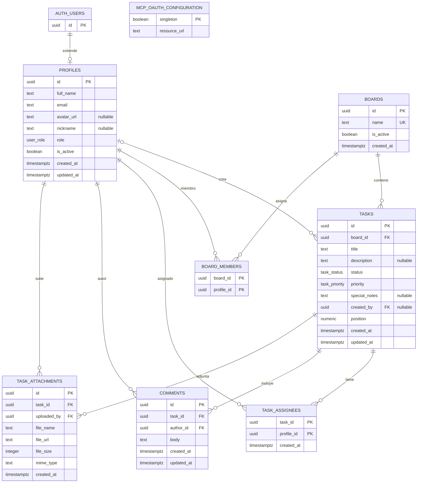

# Schema de persistencia Supabase

La persistencia es PostgreSQL gestionado fuera de la SPA. `supabase-schema.sql` es el bootstrap completo; `supabase/migrations/` contiene cambios incrementales. Fase 2 local agrega `202610280003_mcp_task_read.sql` y sus objetos al bootstrap; no se ha verificado su aplicación remota. Sesiones y clientes OAuth pertenecen al schema administrado `auth`; la nueva tabla de permisos es del producto.

Última evidencia remota registrada de fase 1 (2026-10-28, no repetida aquí): `202610280002` se ejecutó transaccionalmente y `tests/mcp_identity.sql` pasó con `ROLLBACK`. El ledger enumeraba `202610190001`, `202610200001`, `202610200002`, `202610210001`, `202610220001` y `202610280002`, pero el schema incluía cambios de `202610220002`, `202610280001` y algunas policies de `202610260003`. No se encontraron la policy de renombrado `202610260001` ni la RPC `202610260002`. No inferir migraciones aplicadas por objetos ni ejecutar `db push` a ciegas. [Preparación de fase 2](../docs/prueba-mcp.md); `supabase/README.md` conserva una guía anterior, no sustituye esta discrepancia.

## Modelo relacional

Fuente: `supabase-schema.sql` y `supabase/migrations/202610210001_boards.sql:4-22`, `supabase/migrations/202610220002_board_lifecycle.sql:5`.

## Enumeraciones y reglas de persistencia

- `user_role`: `admin`, `usuario`, `invitado` (`supabase-schema.sql:10`).
- `task_status`: `backlog`, `por_hacer`, `haciendo`, `en_revision`, `finalizadas` (`supabase-schema.sql:12`).
- `task_priority`: `urgente`, `alta`, `normal`, `baja` (`supabase-schema.sql:14`).
- `handle_updated_at()` actualiza `updated_at` en perfiles, tareas y comentarios (`supabase-schema.sql:117-137`).
- `handle_new_user()` crea el perfil tras insertar en `auth.users` y asigna inicialmente el rol `usuario` (`supabase-schema.sql:142-158`).
- `profiles.is_active` es obligatorio/default `true`; la migración activa las cuentas existentes sin modificar sus roles (`supabase/migrations/202610190001_user_administration.sql:4`). No es un flag de borrado ni un ban en Auth.
- Hay índices por estado, prioridad y creador de tarea, así como por tarea/autor de comentario y tarea de adjunto (`supabase-schema.sql:103-111`).

## Políticas RLS declaradas

RLS está habilitado para las tablas de aplicación. La tabla resume el contrato
histórico de membresía hasta `202610220002`. **Prevalece en el portal local** la
ampliación `202610280001_board_assignment_access.sql:4-42`: admin activo o tablero
activo con membresía **o asignación**. El catálogo agrega `my_pending_count` y
`people` (`:44-83`). Esto no crea membresía; tampoco amplía la RPC MCP, que exige
membresía explícita para no admin. No certifica configuración remota.

| Recurso | Operación | Condición resumida | Fuente |
| --- | --- | --- | --- |
| `profiles` | select | cuenta activa lee perfiles; cuenta inactiva autenticada puede leer únicamente el propio para mostrar bloqueo | `supabase/migrations/202610190001_user_administration.sql:18-38` |
| `profiles` | update cliente | conserva RLS dueño/admin, exige cuenta activa y solo concede columnas `full_name`, `avatar_url`, `nickname`; no `role` ni `is_active` | `supabase-schema.sql:179-193`, `supabase/migrations/202610190001_user_administration.sql:14-16`, `:33-35` |
| `tasks` | select | autenticado activo por RLS | `supabase-schema.sql:199-202`, `supabase/migrations/202610190001_user_administration.sql:24-30` |
| `boards` | select | Admin activo ve todos (activos y desactivados); otras cuentas activas solo los tableros **activos** de `board_members`. La policy no invoca funciones que lean `boards` (anti-recursión con `INSERT ... RETURNING`) | `supabase/migrations/202610220002_board_lifecycle.sql:12-24` |
| `boards` | insert | Solo admin activo; nombre único (case-insensitive), recortado de 1–120 caracteres. La fila nace con `is_active = true` | `supabase/migrations/202610210001_boards.sql:4-9,47-48`, `supabase-schema.sql:574-580` |
| `board_members` | select (admin) | Solo admin lee la tabla completa de membresías; RPC admin sustituye perfiles existentes/activos. Sin alta directa cliente | `supabase/migrations/202610210001_boards.sql:42-49,63-80` |
| `board_members` | select (miembro) | Cada miembro autenticado lee **su propia fila** (`profile_id = auth.uid()`); no expone membresías ajenas | `supabase/migrations/202610220002_board_lifecycle.sql:7-10` |
| `tasks` | insert | requiere rol `admin`/`usuario` activo; el propietario lo fija la RPC, no el cliente | `supabase-schema.sql:204-213`, `supabase/migrations/202610200001_task_assignments.sql:47-76` |
| `tasks`, `task_assignees`, `comments`, `task_attachments` | todas | Policy restrictiva exige membresía del tablero de la tarea o admin activo. Ser responsable no otorga acceso | `supabase/migrations/202610210001_boards.sql:51-59` |
| `tasks` | update | **edición compartida dentro de tablero accesible**: cualquier cuenta autenticada activa puede actualizar cualquier tarea que puede consultar; `board_id` además se protege por policy/grants/RPC | `supabase-schema.sql:215-221`, `supabase/migrations/202610200002_shared_task_editing.sql:9-14`, `supabase/migrations/202610210001_boards.sql:51-53` |
| `tasks` | update (columnas cliente) | solo `title`, `description`, `status`, `priority`, `position`; `created_by` no es escribible | `supabase-schema.sql:448-450`, `supabase/migrations/202610200002_shared_task_editing.sql:16-17` |
| `tasks` | delete | creador o admin; gate restrictivo de cuenta activa | `supabase-schema.sql:223-232`, `supabase/migrations/202610190001_user_administration.sql:24-30` |
| `task_assignees` | select | autenticado activo por RLS | `supabase-schema.sql:241-244`, `supabase/migrations/202610190001_user_administration.sql:24-30` |
| `task_assignees` | escrituras cliente | INSERT/UPDATE/DELETE revocados; los predicados históricos no conceden permisos por sí solos | `supabase/migrations/202610200001_task_assignments.sql:5` |
| `task_assignees` | RPC | cuenta activa de cualquier rol con acceso al tablero sustituye responsables; la RPC no edita la tarea | `supabase/migrations/202610200001_task_assignments.sql:7-45`, `supabase/migrations/202610210001_boards.sql:82-92` |
| `comments` | select/insert/update/delete | gate activo AND políticas anteriores: lectura autenticada, alta admin/usuario, update/delete autor/admin | `supabase-schema.sql:273-309`, `supabase/migrations/202610190001_user_administration.sql:24-30` |
| `task_attachments` | select/insert/update(`file_name`)/delete | gate de cuenta activa y acceso al tablero; SELECT para autenticados, INSERT admin/usuario, UPDATE de `file_name` y DELETE para uploader, creador de tarea o admin activo. El cliente no puede modificar las demás columnas | `supabase-schema.sql:314-340,458-461,617-628`, `supabase/migrations/202610260001_task_attachment_management.sql:4-22`, `supabase/migrations/202610190001_user_administration.sql:24-30` |

Los comentarios de algunas policies de Storage describen roles distintos de lo que comprueba su predicado. El predicado SQL es la evidencia de esta tabla de Storage; no se interpreta aquí la intención de seguridad. Contrastar con `specs/05-auth-roles-permisos.md` y solicitar revisión de seguridad antes de cambiarlo.

### Funciones y autorización explícita

`is_active_account()` es `SECURITY DEFINER`, `STABLE`, con `search_path = ''`; consulta `profiles` por `auth.uid()` sin recursión RLS. `is_board_admin()`, `can_access_board()` y `can_access_task()` encapsulan las comprobaciones necesarias para policies y RPCs (`supabase/migrations/202610210001_boards.sql:24-41`).

Las RPCs de tareas/tableros son `SECURITY DEFINER` con path vacío y ejecución para `authenticated`. `set_task_assignees` aplica acceso a tablero y delega validaciones existentes; `create_task_with_assignees` exige admin/usuario activo y acceso al tablero, y calcula posición dentro de tablero/estado; `move_task_to_board` requiere acceso a origen y destino y actualiza el mismo registro; `set_board_members` reserva la sustitución de miembros al admin. El cliente no escribe directamente `board_id` ni las membresías (`supabase/migrations/202610210001_boards.sql:63-131`).

### Ciclo de vida de tableros

La migración `202610220002_board_lifecycle.sql` (aplicada en el proyecto Supabase remoto el 2026-10-22, después de `202610220001_board_access_returning.sql`) añade el ciclo de vida del tablero. `supabase-schema.sql` ya incluye los mismos objetos para instalaciones nuevas (`supabase-schema.sql:574-580,599-633,663-708`).

| Objeto | Contrato | Fuente |
| --- | --- | --- |
| `boards.is_active` | `boolean not null default true`; desactiva sin borrar contenido ni membresías | `supabase/migrations/202610220002_board_lifecycle.sql:5` |
| Policy «Accessible boards» (reescrita) | Admin activo ve todo; el resto solo tableros activos de los que es miembro. **No llama a ninguna función que lea `boards`** | `supabase/migrations/202610220002_board_lifecycle.sql:12-24` |
| Policy «Members read own memberships» | Cada miembro autenticado lee su propia fila de `board_members` | `supabase/migrations/202610220002_board_lifecycle.sql:7-10` |
| `can_access_board(p_board_id)` (reescrita) | Exige `b.is_active` para los miembros; el admin activo conserva acceso a cualquier tablero | `supabase/migrations/202610220002_board_lifecycle.sql:27-36` |
| RPC `rename_board(p_board_id, p_name)` | Solo admin (`42501`); nombre recortado de 1–120 (`22023`); tablero inexistente (`P0002`); unicidad por índice `lower(name)` | `supabase/migrations/202610220002_board_lifecycle.sql:38-54` |
| RPC `set_board_active(p_board_id, p_active)` | Solo admin (`42501`); alterna `is_active` sin borrar tareas, comentarios, adjuntos ni membresías | `supabase/migrations/202610220002_board_lifecycle.sql:56-66` |
| RPC `list_boards_with_pending_counts()` | Devuelve `id, name, is_active, created_at, pending_count` con la misma visibilidad que RLS; `pending_count` suma tareas en `backlog`, `por_hacer` y `haciendo` | `supabase/migrations/202610220002_board_lifecycle.sql:68-85` |
| RPC `delete_inactive_board(p_board_id)` | Solo admin activo; bloquea y vuelve a validar el tablero inactivo (`55000` si está activo), elimina tareas y luego tablero; `void` | `supabase-schema.sql:727-739`, `supabase/migrations/202610260002_delete_inactive_boards.sql:5-25` |

Las tres RPCs se revocan a `public`/`anon` y se conceden a `authenticated` (`supabase/migrations/202610220002_board_lifecycle.sql:87-90`).

La RPC de borrado también se revoca a `public`/`anon` y se concede a `authenticated` en el bootstrap y la migración local (`supabase-schema.sql:756-760`, `supabase/migrations/202610260002_delete_inactive_boards.sql:24-25`); la comprobación de admin activo y estado inactivo vive dentro de la función `SECURITY DEFINER`.

**Justificación anti-recursión.** `INSERT ... RETURNING` de PostgREST evalúa también la policy de lectura de `boards`. Si esa policy consultara `can_access_board()` y esta leyera `public.boards`, la evaluación volvería a disparar la policy y Postgres detectaría recursión infinita en la policy. Por eso:

1. `202610220001_board_access_returning.sql` reescribe `can_access_board()` para que **no** lea `public.boards`: consulta únicamente `board_members` (`supabase/migrations/202610220001_board_access_returning.sql:5-14`).
2. `202610220002_board_lifecycle.sql` reescribe la policy «Accessible boards» para que tampoco invoque esa función: comprueba la pertenencia con un `EXISTS` directo sobre `board_members` y la condición `boards.is_active` en el propio predicado (`supabase/migrations/202610220002_board_lifecycle.sql:12-24`).

Consecuencia observable: `can_access_board()` sí puede leer `boards` (necesita `is_active`), pero **la policy de lectura de `boards` ya no lo hace**. Añadir en el futuro una función que lea `boards` a esa policy reintroduciría la recursión.

**Efecto del apagado.** Con `is_active = false`, los miembros pierden la lectura del tablero y `can_access_board()` deja de concederles acceso a sus tareas, comentarios, adjuntos y asignaciones —también por URL directa—, porque la policy restrictiva «Board access required» se apoya en `can_access_board()` (`supabase/migrations/202610220002_board_lifecycle.sql:27-36`, `supabase-schema.sql:634-641`). El admin activo mantiene el acceso y puede reactivar el tablero; la membresía no se borra.

### Edición compartida de tareas

La migración `202610200002_shared_task_editing.sql` amplía el `UPDATE` de `tasks` a toda cuenta autenticada activa y sustituye el permiso de tabla completo por permisos por columna (`supabase/migrations/202610200002_shared_task_editing.sql:1-19`):

- La policy `Active accounts can update tasks` reemplaza a `Creators and admins can update tasks` y se aplica `to authenticated` con `using (true)` / `with check (true)`. La policy restrictiva `Active account required` sigue ANDando, de modo que una cuenta desactivada no escribe aunque conserve la sesión.
- `revoke update on public.tasks from anon, authenticated` elimina el privilegio de tabla; `grant update (title, description, status, priority, position) to authenticated` concede solo las columnas editables. `created_by`, `created_at`, `updated_at` e `id` quedan fuera del alcance de escritura del cliente.
- Esa separación de columnas es la que impide escalar privilegios: con `UPDATE` abierto y `created_by` escribible, cualquiera podría reclamar la propiedad de una tarea ajena y después borrarla, porque la policy de borrado comprueba `created_by = auth.uid()`.
- El borrado no se amplía: sigue requiriendo ser creador o `admin`. La creación sigue reservada a `admin`/`usuario` y su propietario lo deriva `auth.uid()`.
- `updated_at` lo mantiene el trigger `set_tasks_updated_at`; no requiere privilegio de columna para el cliente.

La migración es idempotente respecto a la policy (usa `drop policy if exists` para el nombre anterior y el nuevo) y no toca las RPCs de asignación ni las vistas.

### Gestión de adjuntos

La migración `202610260001_task_attachment_management.sql` concede `UPDATE` únicamente sobre `task_attachments.file_name` y añade una policy para renombrar filas del uploader, del creador de la tarea o de un admin activo. El gate restrictivo de cuenta activa y el de acceso al tablero continúan aplicándose. El borrado conserva los mismos actores autorizados en metadata y Storage (`supabase-schema.sql:327-340`; Storage en `supabase/migrations/202610210001_boards.sql:152-159`).

El renombrado modifica solo `file_name`: no mueve el objeto ni altera su path, MIME o contenido. El modelo no añade tablas ni columnas. En una instalación nueva, el grant y la policy están en `supabase-schema.sql`; en una existente se aplica `202610260001_task_attachment_management.sql` después de `202610220002_board_lifecycle.sql`. La migración no se aplicó ni verificó en Supabase remoto durante esta actualización; la suite SQL local tampoco se ejecutó porque no había un stack Supabase local disponible.

### Borrado permanente de tableros inactivos

`delete_inactive_board(uuid)` exige admin activo y un tablero existente con `is_active = false`. Bloquea la fila, elimina las tareas del tablero y después la fila de `boards`; las FK eliminan por cascada asignaciones, comentarios y metadata de adjuntos. La FK de `tasks.board_id` usa `ON DELETE RESTRICT`, por lo que el borrado explícito de tareas precede al de tablero (`supabase-schema.sql:727-739`, `supabase/migrations/202610260002_delete_inactive_boards.sql:5-21`).

La API cliente enumera metadata/paths y elimina objetos de Storage antes de invocar la RPC. La limpieza de archivos y la transacción PostgreSQL no son atómicas: si falla Storage, la RPC no se invoca; si falla la RPC después de Storage, los objetos pueden haberse eliminado aunque las filas sigan. La migración local no se verificó en remoto (`src/features/boards/api.ts:69-145`).

## Role, hook y persistencia auxiliar del MCP

El MCP no agrega columnas de negocio a `profiles`. Declara configuración de recurso
y, en fase 2, una tabla de consentimiento por sesión. Usa `auth.sessions` para
comprobar revocación/expiración:

| Objeto | Propósito y permisos | Fuente |
| --- | --- | --- |
| Rol SQL `mcp_identity` | `NOLOGIN NOINHERIT`; no hereda roles privilegiados ni tiene grants de tablas/vistas/Storage. Fase 2 permite `mcp_whoami()` y `mcp_get_task(...)`, no RPCs de escritura ni de autoautorización | `supabase/migrations/202610280002_mcp_identity.sql:4-10,73-109`, `202610280003_mcp_task_read.sql:39-40,60-61,115-116` |
| `public.mcp_oauth_configuration` | Singleton `{ singleton: true, resource_url: text }`; RLS activado y sin grants cliente/MCP. La URL debe coincidir byte a byte con JWT `aud` | `supabase/migrations/202610280002_mcp_identity.sql:12-21` |
| `public.mcp_access_token_hook(event jsonb)` | Auth la ejecuta como `supabase_auth_admin`. Tokens ordinarios salen inalterados; OAuth requiere un perfil activo y recibe `client_id`, `role=mcp_identity`, `aud=resource_url` | `supabase/migrations/202610280002_mcp_identity.sql:23-45` |
| `public.mcp_whoami()` | `SECURITY DEFINER`, path vacío; requiere rol, cliente y audiencia MCP, sesión vigente en `auth.sessions` con el mismo usuario/cliente y perfil `is_active`. Devuelve identidad, no acceso general a datos | `supabase/migrations/202610280002_mcp_identity.sql:47-74` |
| Policies «OAuth identity isolation» | Se conservan las restricciones sobre tablas/Storage; la lectura MCP se hace con autorización explícita dentro de su propia RPC `SECURITY DEFINER`, no relajando policies del portal | `supabase/migrations/202610280002_mcp_identity.sql:76-109`, `202610280003_mcp_task_read.sql:63-116` |
| `mcp_task_read_permissions` | `session_id uuid` PK/FK `auth.sessions(id)` con `ON DELETE CASCADE`; `profile_id uuid` FK `profiles(id)` con cascada; `client_id uuid not null`; `granted_at timestamptz not null default now()`. RLS, sin grants cliente/MCP; índice `(profile_id, client_id)` | `supabase/migrations/202610280003_mcp_task_read.sql:4-12` |
| `mcp_set_task_read_access(uuid, boolean)` | Solo portal `authenticated` sin `client_id`, perfil activo. Autoriza sesiones vivas propias del cliente indicado o elimina sus permisos. No autoriza sesiones futuras | `supabase/migrations/202610280003_mcp_task_read.sql:16-40` |
| `mcp_list_task_read_access()` | Solo portal activo; agrupa sesiones propias vivas por cliente. `enabled=bool_or(permiso)` y `needs_authorization=bool_or(sin permiso)`; no expone IDs de sesión | `supabase/migrations/202610280003_mcp_task_read.sql:42-61` |
| `mcp_get_task(uuid, integer, integer, integer)` | Solo rol MCP; identidad/sesión, consentimiento y acceso por membresía/admin explícitos. SQL estable, `SECURITY DEFINER`, path vacío. Proyecciones y páginas, sin escrituras | `supabase/migrations/202610280003_mcp_task_read.sql:63-116` |

`mcp_identity` es un rol de conexión Postgres, **no** un valor adicional de
`profiles.role`. El hook opera sobre cualquier cliente OAuth del proyecto, no sólo
MCP; no sustituir un hook anterior ni habilitar el patrón en proyectos con otros
clientes OAuth sin revisar el efecto global.

La nueva migración presupone la fase 1, tablas/relaciones de tareas y tableros,
`boards.is_active` y el esquema OAuth de Supabase. El bootstrap incluye fase 1 y
fase 2 para instalaciones nuevas; no se reejecuta sobre una base existente. Los
probes locales revierten fixtures, pero **la migración sí crea objetos persistentes**
al aplicarla. No ejecutar el harness simulado contra un proyecto Supabase.

## Storage

| Bucket | Visibilidad declarada | Operaciones/policies del SQL | Fuente |
| --- | --- | --- | --- |
| `avatars` | Público | Lectura pública; insertar/reemplazar solo el propietario o admin activo; tamaño máximo 2 MiB y MIME JPEG/PNG/WebP | `supabase-schema.sql:348-351,363-404`, `supabase/migrations/202610260003_profile_avatars.sql:5-50` |
| `task-attachments` | Privado (`public = false`) | Acceso condicionado por tablero y rol; el path nuevo incluye UUID de tarea; los paths legacy se resuelven mediante metadata de adjunto | `supabase-schema.sql:353-356`, `supabase/migrations/202610210001_boards.sql:133-172` |

A esas policies se añaden restricciones de cuenta activa para los buckets gestionados. Lecturas de avatares públicos permanecen públicas; las lecturas de adjuntos privados y las escrituras en ambos buckets requieren estado activo. La migración de avatares local refina las escrituras a propietario o admin activo; su efecto remoto no se verificó. No se revocan archivos descargados ni URLs firmadas previas (`supabase/migrations/202610190001_user_administration.sql:40-52`).

La carga de avatar usa `avatars/<profile-id>/avatar` con `upsert`; después actualiza `profiles.avatar_url` a la URL pública. La validación cliente y el bucket admiten JPEG, PNG o WebP hasta 2 MiB. La actualización de Storage y la fila de perfil son operaciones separadas (`src/features/users/avatarApi.ts:3-35`).

El cliente obtiene URLs firmadas de 60 segundos para detalle y miniaturas, refrescando cada 45 segundos. La metadata aún almacena `getPublicUrl`, pero no se usa directamente para mostrar el archivo; persiste la diferencia representacional D-02. El path nuevo `<taskId>/<UUID>.<ext>` y borrado comprobado alinean nuevas cargas; la policy también resuelve paths planos legacy vía metadata. La migración marca `task-attachments` privado. El cambio del nombre visible invalida la lista de adjuntos y las miniaturas, sin modificar el objeto. El contenido ya descargado o enlaces firmados ya emitidos no pueden revocarse retroactivamente.

MCP fase 2 no concede acceso Storage al rol OAuth: Edge firma con credencial solo
servidor después de la RPC autorizada. Su validador requiere origen Supabase exacto,
bucket esperado y path de dos segmentos `<task-id>/<archivo>`; no firma paths legacy,
de otras tareas, hosts ni buckets. Esos adjuntos se listan con `download_error`.
Fuentes: `supabase/functions/mcp/index.ts:72-84`, `supabase/functions/mcp/task.ts:49-92`.

## Vistas

- `tasks_with_assignees`: agrega datos de perfiles asignados (`supabase-schema.sql:408-424`).
- `tasks_with_stats`: calcula conteos distintos de comentarios y adjuntos (`supabase-schema.sql:426-435`).
- `fetchTasks` usa `tasks_with_stats` solo para `id` y `comment_count`; los perfiles asignados se siguen leyendo mediante relación directa desde `tasks`. No solicita el `attachment_count` disponible en la vista (`src/features/board/api.ts:5-35`).
- Ambas vistas se alteran con `security_invoker = true` para respetar los permisos/RLS del llamador (`supabase/migrations/202610190001_user_administration.sql:54-56`).

## Coherencia referencial pendiente

`comments.author_id` y `task_attachments.uploaded_by` se declaran `NOT NULL`, pero sus claves foráneas usan `ON DELETE SET NULL` (`supabase-schema.sql:73-76`, `supabase-schema.sql:89-93`). Esa combinación se registra como deuda D-01; no se modifica el SQL en esta operación.
